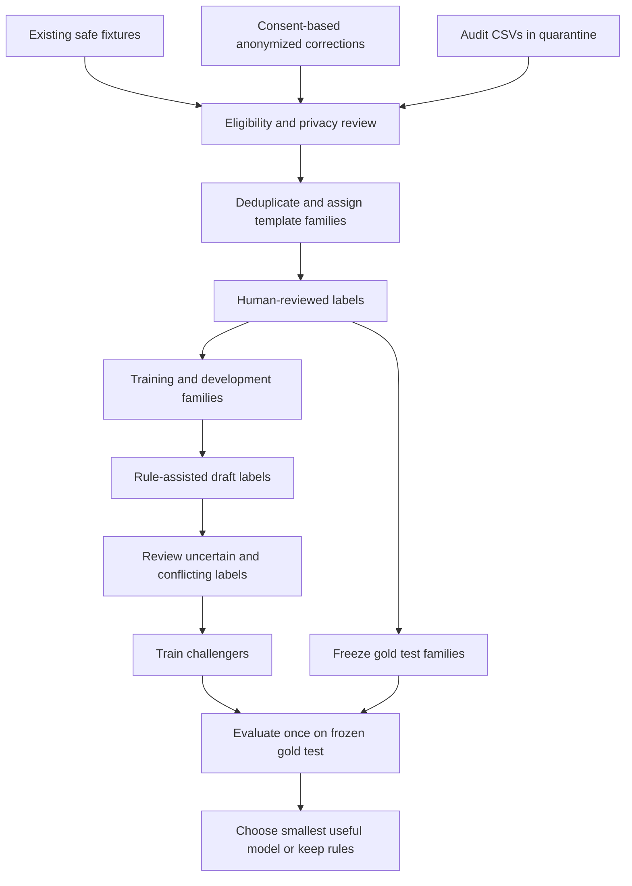
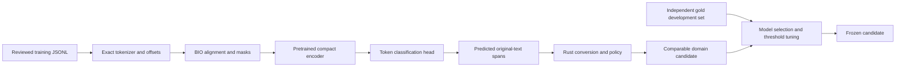
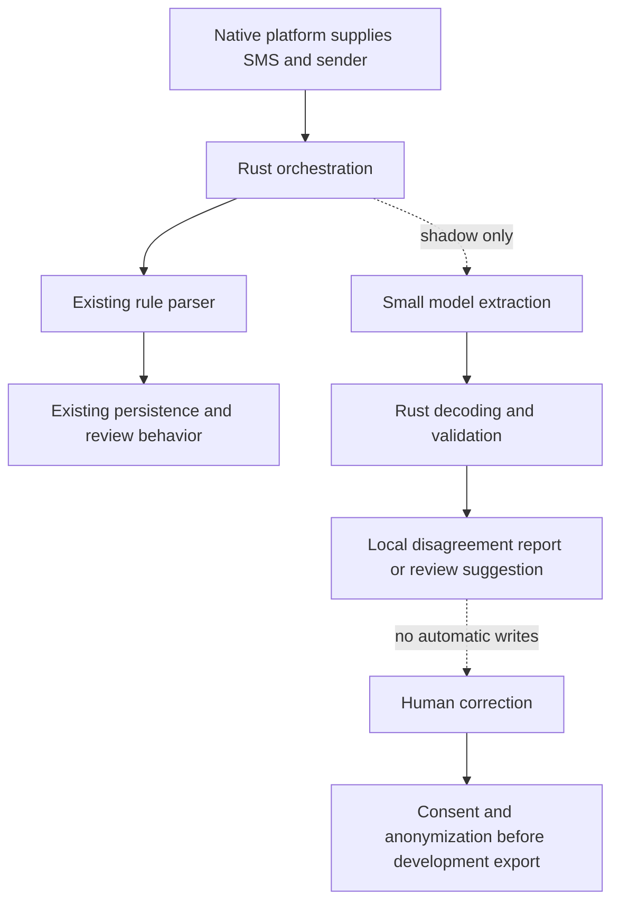
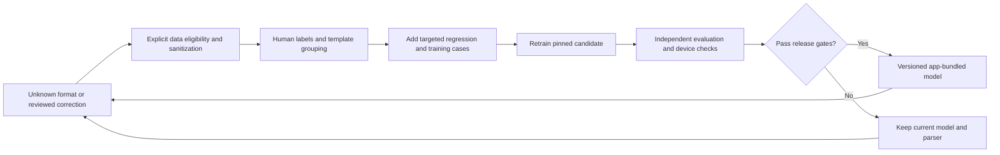

# Centwise SMS Parse Model: Research and Beginner Build Guide

> **For agentic workers:** If implementation is requested later, use `superpowers:executing-plans` to implement the checked-off tasks sequentially. This document authorizes no product implementation, dependency installation, model download, deployment, or data upload.

**Date:** 2026-10-21, Asia/Dhaka.  
**Status:** Research and proposed experiment plan; no model has been trained.  
**Goal:** Create and evaluate our own small, offline SMS extraction model using reviewed Centwise examples while preserving the existing Rust parser.  
**Architecture:** Independent offline challenger first. Small pretrained encoder learns text spans; Rust retains exact money conversion, provider rules, account resolution, validation, categorization, deduplication, and database writes. Mobile integration follows only if evaluation demonstrates a benefit.  
**Tech stack proposed:** Python, PyTorch, Hugging Face Transformers/Tokenizers, a compact BERT encoder, ONNX, ONNX Runtime; existing Rust/UniFFI, Kotlin, Swift.  
**Spec:** The research brief and proposed contracts in this same document. This is not an approved production architecture decision.

## 1. প্রথমে সহজ উত্তর

হ্যাঁ, Centwise-এর নিজের ছোট SMS model তৈরি করা সম্ভব। আমাদের লক্ষ্য নতুন ChatGPT বানানো নয়। লক্ষ্য হলো SMS-এর কোন অংশ transaction amount, fee, balance, merchant, reference, account এবং date তা শেখানো।

প্রথম version-এ existing parser বদলাব না। একই reviewed test messages দিয়ে rule parser ও model দুটোকে পরীক্ষা করব। ভালো ফল প্রমাণিত হলে review queue-তে suggestions হিসেবে ব্যবহার করা যাবে। সরাসরি automatic financial entry অনেক পরের সিদ্ধান্ত।

**Recommendation:** আগে data ও evaluation ঠিক করো, তারপর Google compact BERT-এর দুটি ছোট candidate train করো। প্রয়োজনে verified MiniLM checkpoint-কে stronger comparison হিসেবে আনো। সবচেয়ে ছোট যে model গ্রহণযোগ্য ফল দেয়, সেটাই বেছে নাও। Model হারলে rules রাখাও successful experiment।

**Guarantee নয়:** 100% accuracy, 10 MB size, zero maintenance, automatic learning, অথবা সব bank-এর unseen SMS বোঝার নিশ্চয়তা দেওয়া যায় না। নিচের সংখ্যাগুলোতে observed evidence, estimates, এবং proposed targets আলাদা করা হয়েছে।

## 2. কী পড়বে, কোন সিদ্ধান্ত নেবে

| তোমার প্রশ্ন | পড়ার অংশ |
|---|---|
| Project-এ এখন কী আছে? | Sections 4–5 |
| Parameters, training, size কী? | Sections 3, 8–9 |
| কোন open source/model নেব? | Sections 7–10, 27 |
| Data কোথা থেকে আসবে? | Sections 11–14 |
| কীভাবে train ও test করব? | Sections 15–19 |
| Android/iOS-তে কীভাবে চলবে? | Sections 20–22 |
| খরচ, সময়, maintenance? | Sections 23–25 |
| Developer-এর exact কাজগুলো কী? | Section 26 |
| Research paper ও original sources? | Sections 28–29 |
| এখন কী নির্বাচন করতে হবে? | Section 30 |

## 3. Beginner glossary

| Term | সহজ অর্থ |
|---|---|
| Parameter | Model-এর শেখা numerical weight; SMS count নয় |
| Pretraining | আগে বড় সাধারণ text corpus থেকে language patterns শেখা |
| Fine-tuning | সেই model-কে আমাদের ছোট, নির্দিষ্ট SMS dataset দিয়ে নতুন কাজ শেখানো |
| Encoder | Text-এর প্রতিটি token-এর contextual representation তৈরি করে |
| Token | Model-এর পড়ার unit; word, word fragment, punctuation হতে পারে |
| NER / token classification | Text-এর কোন token কোন field-এর অংশ তা label করা |
| Span | Original text-এর শুরু ও শেষ position দিয়ে নির্বাচিত অংশ |
| BIO tags | `B-AMOUNT` শুরু, `I-AMOUNT` continuation, `O` অন্য text |
| Head | Encoder-এর ওপর ছোট task-specific prediction layer |
| Gold labels | Human-reviewed expected answers |
| Weak labels | Rules বা অন্য model-এর তৈরি provisional answers |
| Distillation | Stronger teacher-এর task knowledge ছোট student model-এ শেখানো |
| Quantization | Weights/operations কম precision-এ represent করে size বা execution cost কমানোর চেষ্টা |
| ONNX | Training framework থেকে exported model graph format |
| Runtime | Phone/computer-এ graph চালানোর engine |
| Precision | Model যে transaction বলেছে, তার কতগুলো সত্যি transaction |
| Recall | সত্যিকারের transaction-এর কতগুলো model খুঁজে পেয়েছে |
| Calibration | Confidence score বাস্তব correctness-এর সঙ্গে কতটা মেলে |
| Abstain | নিশ্চিত নয় বলে review-তে পাঠানো; ভুল entry বানানো নয় |
| Shadow mode | Model result compare করা, user data-তে model দিয়ে পরিবর্তন না করা |
| Template leakage | প্রায় একই SMS format train এবং test দুটোতে থেকে misleading score তৈরি হওয়া |

২২M parameters মানে ২২ million SMS দরকার নয়। Pretrained model-এর আগের knowledge কাজে লাগবে। তবে অল্প reviewed examples থেকে কতটা নতুন-format generalization হবে, তা measurement ছাড়া বলা যাবে না। Compact pretraining এবং distillation-এর ভিত্তি: [compact-model paper](https://arxiv.org/abs/1908.08962), [MiniLM paper](https://arxiv.org/abs/2002.10957).

## 4. Current repository: verified source inventory

এই section বর্তমান checkout-এর সীমিত parser/data/integration inspection; পুরো app-এর security audit বা complete code audit নয়। Working tree শুরুতে clean ছিল। Legacy status documents-এর claims-কে current evidence ধরা হয়নি।

| Existing location | Observed role | Model project-এ ব্যবহার |
|---|---|---|
| `core/centwise-parser/src/engine.rs` | Normalize → safety classification → provider → extraction | Frozen rule baseline; initial weak-label source |
| `core/centwise-parser/src/classify/mod.rs` | Safety/business filters; Bengali-script gate | Rejection analysis; never blindly treat every rejection as true spam |
| `core/centwise-parser/src/extract/` | Amount, type, party, account, date, reference extraction | Compare field-by-field; reuse deterministic conversions |
| `core/centwise-parser/src/types.rs` | `ParsedTransaction`, `ParseOutcome`, `RejectReason` | Evaluation target contract |
| `core/centwise-normalization/src/` | Text normalization and integer-minor amount conversion | Preserve exact money handling; test offset mapping |
| `core/centwise-categorization/src/` | Deterministic category logic | Keep out of initial model scope |
| `core/centwise-parser/src/providers/catalog.rs` | Provider identifiers/sender matching | Keep canonical identity resolution in Rust |
| `docs/supported-providers.json` | Provider support metadata | Coverage matrix; not proof of measured parser accuracy |
| `fixtures/sms/*.json` | Shared expected SMS cases | Small initial reviewed-data candidate pool |
| `core/centwise-parser/src/engine.rs` tests and `core/centwise-parser/tests/` | Additional unit/regression/audit tests | Inventory separately; not included in 69-message total below |
| `fixtures/audits/transaction-reports/` | 11 CSV files | Quarantine pending permission, privacy, duplication and label-quality checks |
| `fixtures/audits/review-queue-reports/` | 5 CSV files | Potential difficult examples; same restrictions |
| `core/centwise-ffi/src/core.rs` | `ingest_sms`, persistence/account/review orchestration | Future inference before DB transaction; preserve write semantics |
| `core/centwise-ffi/src/ingestion.rs` | Standalone parsing and shared ingestion helper | Call-site parity; avoid adding a second divergent pipeline |
| Android `core/processor/SmsTransactionProcessor.kt` | Native ingestion adapter → Rust backend | Platform integration tests later |
| iOS `Core/Processor/SmsTransactionProcessor.swift` | Intent-supplied text → Rust backend | Same model/domain results later |
| `.github/workflows/test.yml`, `release.yml` | Rust checks, Android builds/tests, iOS build steps | Extend existing checks later rather than invent a separate release system |

### 4.1 Actual shared fixture counts

Counted JSON message arrays, using `expected.isTransaction == false` for negatives. Positive rows also have an expected type. This is an inventory, not an independent annotation-quality audit.

| File under `fixtures/sms/` | Positive | Negative | Total |
|---|---:|---:|---:|
| `banks-english.json` | 10 | 5 | 15 |
| `banks-generic.json` | 7 | 0 | 7 |
| `bkash.json` | 17 | 2 | 19 |
| `mfs-english.json` | 5 | 1 | 6 |
| `nagad.json` | 6 | 0 | 6 |
| `rocket.json` | 5 | 0 | 5 |
| `telco.json` | 6 | 5 | 11 |
| **Total** | **56** | **13** | **69** |

CSV row counts, unique template count, PII status, and independently correct labels were not established. Sixteen CSV files do not mean sixteen independent datasets. Do not automatically ingest these CSVs into training.

### 4.2 What current tests prove—and do not prove

Executed successfully:

```powershell
cargo test --manifest-path core/Cargo.toml --locked --offline -p centwise-parser --test fixture_tests
```

Result: **7 fixture test groups passed; 0 failed**. They exercise the seven JSON fixture files. The compiler reported incremental-cache hard-link warnings and copied files instead; execution completed successfully.

Important evaluator gaps observed in `fixture_tests.rs`:

- Optional expected fields are usually checked only when `Some(...)`; missing labels do not necessarily assert that the parser returned `None`.
- The fixture `date` is deserialized as `_date` and is not asserted by that test harness.
- A rejected fixture primarily checks non-transaction status, not every rejection reason.
- The rule parser has already been developed against these fixtures, so these are regression tests, not a clean unseen benchmark.

Therefore do not convert “all fixture groups pass” into “100% parsing accuracy.” The new benchmark must explicitly distinguish **known absent**, **known present**, and **not annotated**.

## 5. What makes the current parser hard to maintain

The current engine already hunts fields rather than relying solely on complete sentence templates. That is a useful design. Maintenance still grows because intent and field roles depend on context:

1. One SMS can contain amount, fee, balance, credit limit, outstanding amount, and a promotional amount.
2. Words such as payment, recharge, received and refunded can describe a request, failure, future event, or posted transaction.
3. Merchant/party text can be multiword, quoted, abbreviated, or followed by unrelated verbs.
4. Sender aliases and bank body identifiers differ.
5. Multiple notifications can describe one financial event.
6. Business meaning is not always inferable from text: an own-account transfer needs account ownership information.

**What ML could improve:** contextual field selection and phrasing tolerance.  
**What ML does not remove:** provider maintenance, exact conversion, duplicate handling, ownership rules, data review, regression tests, and accountability for wrong entries.

An additional observed limitation: Bengali script currently returns `PromotionOrSpam` early in `classify_safety`. That is an implementation routing choice, not proof that Bengali messages are spam. A future Bengali project must separately change routing, tokenizer/model, labels, fixtures, domain tests, and platform parity documentation.

## 6. Experiment brief and boundaries

### 6.1 Agreed intent from this conversation

- Keep the current Rust parser.
- Use current rules/data as a starting point for training.
- Evaluate our own Centwise-branded SMS model before product integration.
- Aim for a small offline artifact, ideally tens of MB and below 100 MB if useful accuracy is achievable.
- Preserve the ability to add related capabilities later.
- Produce a complete research/implementation guide now, not product code.

### 6.2 Proposed first experiment

**Input:** English SMS body plus optional sender hint.  
**Learned output:** spans for transaction amount, fee, balance, merchant/party, reference, account token and date/time.  
**Existing Rust output:** provider, exact minor-unit values, type/business rules, account resolution and final domain record.  
**Evaluation:** rules alone versus model spans plus the same deterministic Rust policy. Also score raw model spans independently so it is clear where improvements came from.

The initial model is an extraction model, not yet a complete replacement of every classification rule. If intent detection is the dominant failure after extraction improves, add a sentence-classification head sharing the same encoder in a later experiment. Do not advertise extraction-only improvements as full intent understanding.

### 6.3 Global constraints

- Raw SMS stays on-device by default; development data needs explicit eligibility and anonymization.
- Only anonymized fixtures and examples belong in Git.
- Rust owns shared domain logic and all database writes.
- Android and iOS have the same domain meaning, validation and review behavior.
- iOS target stays **16.0**; set `IPHONEOS_DEPLOYMENT_TARGET=16.0` for Rust iOS builds or use `scripts/build_ios_libs.sh`.
- No PennyWise source, parser implementations, UI assets or personal test data are copied.
- No new model-triggered DB writes during offline or shadow evaluation.
- Preserve current financial records; no mass reparse or overwrite operation.
- No training from scratch in the first experiment; no paid API dependency.
- Pin actual compatible dependencies and model revisions during implementation; do not treat moving `main` as a reproducible release.

### 6.4 Review focus

| Failure mode | Required behavior |
|---|---|
| Balance confused with amount | Fail exact field-role test; no automatic insertion |
| OTP/offer/failed/pending notice | No model-created transaction; review disputed supported cases without overriding hard safety policy |
| Missing/truncated fields | Explicit unknown/abstention, never fabricated data |
| Tokenization/normalization changes positions | Reject invalid offsets; recover text from the correct source representation |
| Duplicate ingestion or ambiguous account | Existing Rust dedup/account-resolution behavior remains authoritative |

## 7. Approaches compared

These are engineering choices, not measured Centwise results.

| Approach | Benefits | Costs/limits | Decision |
|---|---|---|---|
| Existing Rust rules only | Fast, inspectable, already integrated | Growing contextual exceptions | Mandatory baseline and fallback |
| Character n-gram classifier + CRF extraction | CPU-friendly, potentially very small, works with hand-designed local features | May reproduce rule brittleness; mobile inference needs a separate implementation/export check | Cheap offline baseline; do not assume production runtime support |
| Compact pretrained BERT token classifier | Learns context; fixed labels; standard fine-tuning/export path | Reviewed spans needed; distribution shift and size tradeoffs | **First neural experiment** |
| Single encoder with token + sentence heads | Extraction and intent share one model file | Custom training/export/calibration; not the stock one-head tutorial | Conditional follow-up if intent is a measured bottleneck |
| GLiNER open-label extraction | Useful teacher/annotation comparison; label descriptions | “Small” is not automatically within our mobile budget; separate checkpoint licensing | Optional local teacher, not first phone artifact |
| Generative small LLM returning JSON | Flexible schema/instructions | More output validation, potential invented fields, larger memory/latency scope | Skip for v0 |
| Cloud LLM parser | Stronger model experiments possible | Raw SMS transmission, recurring service cost, network dependency | Outside local-first v0 |

CRF tooling reference: [sklearn-crfsuite](https://github.com/TeamHG-Memex/sklearn-crfsuite). Its Python wrapper is not itself an Android/iOS deployment solution. GLiNER is designed for general entity extraction: [original paper](https://arxiv.org/abs/2311.08526), [repository](https://github.com/urchade/GLiNER).

## 8. Model shortlist and size expectations

### 8.1 Candidates worth checking

| Candidate checkpoint | Approximate parameters | Rough FP32 weights | Hypothetical all-INT8 weights | Proposed use |
|---|---:|---:|---:|---|
| [`google/bert_uncased_L-2_H-128_A-2`](https://huggingface.co/google/bert_uncased_L-2_H-128_A-2) | 4.4M | 18 MB | 4.4 MB | Smallest neural baseline; may underfit difficult roles |
| [`google/bert_uncased_L-4_H-256_A-4`](https://huggingface.co/google/bert_uncased_L-4_H-256_A-4) | 11M | 44 MB | 11 MB | **Default first candidate** |
| [`microsoft/MiniLM-L12-H384-uncased`](https://huggingface.co/microsoft/MiniLM-L12-H384-uncased) | 33M | 132 MB | 33 MB | Stronger challenger if compact BERT falls short |

MB here means approximately one million bytes. Parameter totals are approximate architecture figures; record exact trainable/total counts from the instantiated model. A token head adds parameters. These columns are weight arithmetic, not measured ONNX downloads or RAM requirements.

Google's two linked checkpoint cards identify Apache-2.0 licensing and English uncased BERT miniatures. The linked Microsoft checkpoint card identifies MIT licensing and a 33M-parameter model. Record licenses and revision hashes for the exact files actually used. [Google model family](https://huggingface.co/google/bert_uncased_L-2_H-128_A-2), [Microsoft checkpoint](https://huggingface.co/microsoft/MiniLM-L12-H384-uncased).

### 8.2 Correction to the earlier MiniLM example

The earlier conversation mentioned a 22M MiniLM architecture to illustrate scale. Do not infer that every guessed Hugging Face model ID exists. The Microsoft research repository describes a 22M six-layer architecture, but `microsoft/MiniLM-L6-H384-uncased` could not be fetched during this research. That does not establish a usable checkpoint or its license.

Use the verified 33M Microsoft checkpoint above if testing MiniLM, or explicitly verify another publisher/revision before using it. [Microsoft original repository](https://github.com/microsoft/unilm/tree/master/minilm).

Also, a sentence-embedding model is not automatically a field extractor. A pooled SMS embedding does not tell us which number is the balance. A token-label head and span training are needed for this plan.

### 8.3 কেন 10–20 MB guarantee নয়

```text
FP32 weight bytes ≈ parameter_count × 4
FP16 weight bytes ≈ parameter_count × 2
INT8 weight bytes ≈ parameter_count × 1
```

Real export may keep embeddings or some operations in FP32, add graph metadata, or produce multiple files. Dynamic quantization of matrix multiplication does not imply every embedding table becomes INT8. Smaller models can have a large fraction of their parameters in embeddings, so the simple 4× reduction can be misleading.

**Proposed budgets, not observations:** prefer a model bundle under 50 MB; reject candidates over 100 MB unless an explicit later product decision changes the budget. A useful 10–20 MB artifact is an experiment target, not a promise. The bundle budget includes weights, tokenizer, labels, config, and any external tensor files. Report runtime library overhead separately.

## 9. What exactly makes this “our own model”?

We own the task definition, eligible dataset, reviewed labels, training recipe, task head, evaluation, release process, and Centwise versioned artifact. We fine-tune permitted pretrained weights rather than invent a new language architecture.

Branding a fine-tuned artifact does not erase upstream license notices. “Our model” also does not mean no one can inspect/extract it from a phone. Keep confidential data and secrets out of the training corpus and bundle.

No per-SMS cloud inference fee is needed for local inference, but training, labeling, hardware, maintenance and app distribution still cost time/resources.

## 10. Tool and runtime choices

### 10.1 Minimal training stack

- PyTorch and Transformers: standard token-classification training.
- Hugging Face fast tokenizer: offsets/subword mapping; serialize the exact tokenizer.
- Plain reviewed JSONL: enough for a first dataset; no new labeling platform is mandatory.
- Optional local Label Studio if manual span labeling becomes cumbersome.
- ONNX export and ONNX Runtime for desktop comparison and the initial mobile portability probe.
- Plain local JSON/CSV aggregate experiment reports; no hosted experiment tracker required.

The official [token-classification guide](https://huggingface.co/docs/transformers/tasks/token_classification) covers fine-tuning and subword label alignment. [Label Studio](https://github.com/HumanSignal/label-studio) offers an Apache-2.0 annotation tool; it is optional and must be configured for local-only data handling.

### 10.2 Runtime comparison

| Runtime | Why consider it | Why not choose blindly? |
|---|---|---|
| [ONNX Runtime](https://onnxruntime.ai/docs/tutorials/mobile/) | Android/iOS deployment documentation; shared ONNX graph; first recommendation | Verify chosen ops, tokenizer packaging, C ABI/Rust bridge, binary size, iOS 16 and quantized kernels |
| [LiteRT](https://developers.google.com/edge/litert) | Mobile-focused runtime, Android and iOS routes | Conversion/operator support must be proven for our graph; do not maintain a second format without need |
| [ExecuTorch](https://docs.pytorch.org/executorch/stable/index.html) | PyTorch edge deployment with Android/iOS paths | Additional export/lowering/backend choices; compare only if ONNX blocks us |
| Core ML via an Apple adapter | Potential native Apple acceleration | Separate conversion/parity work and Android runtime still needed; defer |

**Recommendation is provisional:** prove one tiny trained graph on both phone platforms before committing to ONNX Runtime as the production choice. Supporting two mobile OSs does not automatically mean a prebuilt package works with our deployment target, Rust build system or extension constraints.

ONNX Runtime is MIT-licensed. Its repository also documents possible usage-data collection: audit and disable telemetry/network-capable components for the selected build, and verify offline operation rather than assuming “local inference” proves zero network activity. [Runtime repository](https://github.com/microsoft/onnxruntime).

## 11. Dataset strategy: use rules as helpers, not ground truth



### 11.1 Sources and limits

| Source | Permitted initial role | Conditions |
|---|---|---|
| Existing shared fixtures | Seed regression set, annotation schema pilot | Re-review anonymization and correctness; not unseen validation |
| Inline Rust regression examples | Additional seed candidates | Inventory provenance; deduplicate against fixtures |
| Audit CSVs | Quarantine only initially | Inspect locally for permission, real identifiers, private balances, duplicate reports and incorrect prior predictions |
| User corrections | Future gold candidate | Explicit consent before any development export; sanitize before Git or hosted tooling |
| Synthetic messages | Training augmentation | Based on eligible templates, checked semantics; never the main claim of real-world accuracy |
| Public SMS datasets | Optional research/negative-data source | Verify origin, licensing, privacy and Bangladesh relevance |
| PennyWise data/code | Not a Centwise training source | Follow `AGENTS.md` reference boundary |

The public [UCI SMS Spam dataset card](https://huggingface.co/datasets/ucirvine/sms_spam) is spam/ham data, not Bangladesh bank-field supervision; that card displays an unknown license. Do not silently import it into the proprietary product. It cannot establish amount/balance extraction performance.

### 11.2 Label quality tiers

- **Gold:** human verified; benchmark/calibration and highest-priority training data.
- **Silver:** rule-generated or teacher-generated and explicitly provisional; training only after sampling/review policy.
- **Unlabeled:** eligible messages waiting for annotation; never pretend parser outputs are verified answers.

A rule that misses a transaction cannot tell us its true label. Do not label all rejected SMS “not transaction.” `NoAmountFound` might mean the extractor failed. `PromotionOrSpam` may include unsupported language in today's implementation.

Simple rules + review is enough initially. [Snorkel](https://github.com/snorkel-team/snorkel) is an optional weak-supervision research/tooling reference if overlapping label sources become numerous; do not add it just to wrap one parser.

### 11.3 Data quantity: planning milestones, not guarantees

| Stage | Suggested reviewed-data goal | What it can establish |
|---|---|---|
| Existing 69 shared messages | Verify schema and annotation process | Tooling sanity, not generalization |
| 300–500 diverse messages | Pilot across chosen provider/template families | Whether span learning is plausible |
| 1,000–3,000 diverse messages | Broader challenger comparison | Learning curves and error clusters |
| Additional targeted batches | Rare events, new formats, hard negatives | Coverage gains measured independently |

These are collection milestones chosen for this project, not research-proven minimums. If there are too few independent families, even thousands of near-duplicates will not validate generalization. Report sample count, family count, provider coverage, negative categories and confidence intervals together.

Do not pad a dataset to a target number just to unlock training. A small pilot can reveal broken labeling/export quickly; production decisions need much stronger independent evidence.

## 12. Privacy and anonymization procedure

1. Keep raw/private sources outside the Git checkout in an access-controlled local location. The current `.gitignore` is not a complete ML-data privacy policy.
2. Confirm rights/consent for each source. Already being present in a CSV does not establish training permission.
3. Replace personal names, phone/account/card identifiers, transaction references, timestamps and balances with invented test values before committed datasets are produced.
4. Preserve the **shape and role relationships** needed to learn: masked account stays masked, reference remains alphanumeric, fee stays distinct from amount, date layout remains representative.
5. Preserve valid business semantics when varying fields. When a receipt contains totals/fees, change related values consistently according to its documented meaning.
6. If the source is already masked, still check remaining identifiers, names, private balances, links and metadata.
7. Regenerate span offsets after sanitization. Never retain offsets pointing into the old text.
8. Review sanitized exports before using an annotation service, cloud notebook or sharing tool. Default training is local; hosted compute accepts only explicitly approved sanitized data.
9. Keep a local source-to-sanitized mapping only if necessary, securely and separately; do not commit it.
10. Exclude raw SMS from console logs, assertion messages, CI artifacts, crash reports and training trackers. Use example IDs and aggregate metrics.
11. Add automated checks and manual spot review; a regex scanner alone does not establish that all PII is gone.
12. Record retention/deletion decisions. Local user correction does not authorize uploading or automatic centralized retraining.

Model weights may memorize training strings; sanitizing training data is required even when the final model runs offline. Generic placeholders such as `[AMOUNT]` for every value erase the numeric variation the model needs; use deliberately synthetic values instead where appropriate.

## 13. Annotation contract

### 13.1 First label set

| Span label | Meaning | Leave to Rust |
|---|---|---|
| `AMOUNT` | Main posted movement amount text | Exact currency/minor-unit parsing |
| `FEE` | Explicit service/transaction fee | Validation and accounting policy |
| `BALANCE` | Explicit relevant post-transaction balance | Distinguish from limits/outstanding; unknown if ambiguous |
| `MERCHANT` | Merchant name where clearly identified | Category mapping/user rules |
| `PARTY` | Other counterparty name/number | Ownership and account relationships |
| `REFERENCE` | Transaction reference as written | Deduplication policy |
| `ACCOUNT` | Relevant account/card identifier token | Mask processing, last-four and resolution |
| `DATE_TIME` | Event date/time text | Locale/time-zone parsing and fallback |

Start with non-overlapping spans. If merchant is a party, annotate `MERCHANT` according to the written policy rather than applying two overlapping BIO tags. Derive `party` fallback in the adapter where the existing contract needs it. Unknown recipient is not a guessed merchant.

Do not label currency limits or outstanding debt as `BALANCE` merely because they are large numbers. Multi-account and multiple-event messages require explicit review policy; a single-record model should abstain instead of choosing silently.

### 13.2 Message-level labels

Even when v0 keeps Rust intent detection, human annotation must record intent independently so the benchmark exposes rule failures:

```text
posted_debit
posted_credit
posted_refund
posted_transfer_explicit
otp_security
promotion
failed_or_pending
balance_or_statement_only
other_non_transaction
uncertain
```

These are research labels, not new production enum variants. Document a mapping to existing `TransactionType` and `RejectReason`. An explicit transfer phrase does not prove the accounts belong to the user. Loans, card repayments, cash withdrawals and reversals follow existing documented business semantics; unclear policy needs a product decision before labels are frozen.

### 13.3 Example record: wholly synthetic

Character offsets below are **Unicode scalar/code-point indices**, start inclusive and end exclusive, into the stored `text`. Do not interchange Python indices, UTF-8 byte offsets and Swift UTF-16 offsets.

```json
{
  "id": "synthetic-demo-001",
  "text": "Payment Tk 125.50 to DEMO SHOP. Fee Tk 2.00. Balance Tk 900.00.",
  "sender_hint": "bKash",
  "language": "en",
  "source_kind": "synthetic",
  "label_quality": "gold",
  "template_family": "demo-payment-fee-balance-v1",
  "message_label": "posted_debit",
  "spans": [
    {"start": 11, "end": 17, "label": "AMOUNT"},
    {"start": 21, "end": 30, "label": "MERCHANT"},
    {"start": 39, "end": 43, "label": "FEE"},
    {"start": 56, "end": 62, "label": "BALANCE"}
  ],
  "expected": {
    "provider_id": "bkash",
    "transaction_type": "expense",
    "amount_minor": 12550,
    "fee_minor": 200,
    "balance_after_minor": 90000,
    "merchant": "DEMO SHOP",
    "reference": null,
    "account_last4": null
  },
  "unannotated_fields": ["raw_date", "account_hint", "category_id", "party"]
}
```

The four example offsets were checked against their exact intended substrings during this write-up. Implementations must still assert every selected substring rather than trusting hand-written positions, and regenerate offsets whenever sanitization changes the text.

Schema rules:

- `null` means reviewed absence, not “we did not bother labeling.”
- A field listed in `unannotated_fields` is excluded from the relevant field metric; report annotation coverage too.
- Missing required metadata is a validation error.
- Spans must be in range, non-overlapping for BIO v0, on valid character boundaries, and select nonempty text.
- Multiple possible `AMOUNT` spans or unclear account ownership are marked uncertain/review, not assigned by first-match guess.
- References retain original case even if the model's vocabulary is uncased. Extract original substrings, not lowercased decoded tokens.
- Classifiable non-transactions need explicit labels even when they contain money amounts; extraction alone must not authorize a transaction.

### 13.4 Human labeling workflow

1. Write a one-page policy with the labels above and examples for every ambiguous event.
2. Label 30–50 diverse sanitized messages manually.
3. Have a second reviewer independently check this pilot where possible. If one person is available, re-review without looking at the draft answer and disclose the limitation.
4. Resolve disagreements into written policy; do not just average conflicting labels.
5. Only then generate rule-assisted annotation drafts for remaining messages.
6. For gold test labels, hide rule/model predictions until the independent answer is recorded.
7. Review all hard negatives and rare money-role cases. Randomly inspect easy positives as well.
8. Keep label-policy version and dataset content hash with each experiment.

## 14. Split data correctly before augmentation

Random row splitting is unsafe because changing a name or amount does not create a new format.

1. Deduplicate exact messages and normalized near-duplicates.
2. Assign family IDs from sanitized structural text, provider and event type; review clustering manually.
3. Link messages from the same original event and all derived augmentations to one family/source group.
4. Freeze independent family groups for test before model selection.
5. Use other groups for training/development/calibration. Proposed starting allocation with enough families: 70% train, 15% development, 15% test by group, approximately stratified by event/provider.
6. Split development again for calibration/threshold fitting if sufficient data; otherwise use nested grouped validation and document uncertainty.
7. Keep additional time-based or provider-held-out tests if enough independently reviewed examples exist.
8. Generate synthetic variants from **training families only**. Never paraphrase held-out text into training.
9. If 69 examples cannot support meaningful groups for all splits, run a small grouped pilot and explicitly call it a pilot. Do not manufacture a convincing test set from copies.
10. Once a final test becomes routine development feedback, retire it as a regression set and collect a new untouched final test for the next release claim.

[StratifiedGroupKFold](https://scikit-learn.org/stable/modules/generated/sklearn.model_selection.StratifiedGroupKFold.html) is useful for preserving group separation with approximate class balance; it does not discover template families or guarantee balanced tiny groups automatically.

Training augmentation may vary synthetic amounts, spacing, case, line breaks, quotation marks, safe merchant names and field order only when the resulting meaning is valid. Keep all descendants with their parent family. LLM-generated text is training assistance, not independent evidence.

## 15. Proposed training pipeline



### 15.1 Start with one standard head

Use `AutoModelForTokenClassification` with the selected compact checkpoint. Initialize a new token head with our fixed `id2label`/`label2id`. Keep both special-token and padding labels ignored in the loss. With eight entity roles, BIO produces `O` plus 16 role tags.

Train a supervised token baseline before adding a custom joint architecture. Message-level negative data can teach all-`O` examples where appropriate, but some rejected messages still contain meaningful amounts; define extraction annotations consistently instead of assuming all negatives have no spans.

Subword policy must be identical in train and evaluation: label the first subtoken per annotated lexical token and mask continuations, or label every subtoken with valid B/I continuation. Choose one documented convention. Word-level examples in public tutorials need adaptation for original character-span annotation.

Do not align labels by `str.find(value)` alone: the same amount may occur twice in different roles. Use reviewed offsets. Special tokens and any sender-prefix tokens are not original body spans.

### 15.2 Keep model preprocessing exact

- Model input v0 is the stored sanitized body. Sender hint goes to deterministic Rust provider detection initially, not a train-only feature the phone lacks.
- Save tokenizer configuration and vocabulary from the exact checkpoint revision.
- Do not rewrite original SMS text after recording annotation offsets.
- If inference uses normalized text, explicitly map normalized spans back to the original or keep model spans scoped to normalized text and convert fields from that same representation. Never apply normalized offsets to the raw SMS.
- Python fast-tokenizer and Rust-tokenizer parity needs tests, especially Unicode whitespace and punctuation.
- English uncased checkpoints are not a credible Bengali solution. Preserve original extraction case regardless of vocabulary casing.
- Start with max length 192 tokens as a proposed setting; inspect the actual length distribution. Record truncation and abstain on unsupported long messages rather than dropping the useful tail silently.

### 15.3 Small initial hyperparameter experiment

These are starting settings to test, not tuned outcomes:

| Setting | Starting choice |
|---|---|
| Model | Google L4/H256; Google L2/H128 comparison |
| Optimizer | AdamW |
| Learning rate | Compare `2e-5` and `5e-5` |
| Batch size | 8 or 16, adjusted to actual hardware |
| Epoch cap | 5 initially; extend only if development evidence supports it |
| Best checkpoint | Development full-record/critical-field metric, not training loss alone |
| Weight decay | 0.01 starting experiment |
| Seeds | 3 for a serious comparison; one for a smoke run |
| Sequence length | 192 initially, measured coverage required |
| Precision | FP32 baseline; mixed precision only where supported and checked |

Early stopping/model selection must never inspect the frozen final test. If there is severe class imbalance, first inspect per-role/per-event errors; add weighted loss or balanced sampling only when justified. Keep weighted synthetic/weak data from overwhelming gold examples.

### 15.4 If intent needs learning later

Add a sentence head to the **same encoder**, with a sentence loss alongside masked token loss. Keep canonical business mapping in Rust. Define both outputs and mask uncertain labels. Standard token-classification export commands will not automatically export a custom two-head model; add an explicit export wrapper/config and parity tests.

Do not train and ship two identical full encoders just to get two heads unless measurements justify the extra memory and size. Distillation is a later tool if a larger teacher provides verified gains—not a prerequisite for the first fine-tune.

## 16. Beginner environment and command guide

### 16.1 What exists versus what must be built

**Exists now:** Rust parser/tests, shared JSON fixtures, Android/iOS native integrations.  
**Does not exist as part of this work:** the Python training pipeline, annotated ML JSONL, model bundle, ONNX integration, evaluation CLI and new Rust inference modules described below.

All `scripts/sms_model/*` commands below are a **proposed CLI contract for implementation**, not commands that currently work. This document does not claim an executable training project has been delivered.

### 16.2 Environment setup to perform when implementation starts

Use a separate Python environment. Python 3.11 is a proposed baseline; confirm the selected PyTorch/Transformers/exporter versions support it before locking.

```powershell
# From D:\workspace\centwise, when the implementation phase begins:
py -3.11 -m venv .venv-sms-model
.\.venv-sms-model\Scripts\python.exe -m pip install --upgrade pip
```

Before creating this environment, add explicit ignore rules for `.venv-sms-model/`, private/intermediate ML data and `artifacts/sms-model/`. Keep only reviewed anonymized ML fixtures under `fixtures/`. This document does not edit `.gitignore`.

Create `scripts/sms_model/requirements.in` for needed direct training/export/test packages, resolve a compatible set in a clean environment, and commit a fully pinned `requirements.lock`. Include PyTorch, Transformers, Tokenizers, NumPy, ONNX, ONNX Runtime, Optimum ONNX tooling, scikit-learn and pytest only as actually required. Use `seqeval` only if it is the chosen span-metric implementation. Record OS/CUDA differences in the lock strategy.

```powershell
# The lock file will be created/tested by the setup task, not by this document.
.\.venv-sms-model\Scripts\python.exe -m pip install -r scripts/sms_model/requirements.lock
```

Do not copy arbitrary “latest” versions into CI or invent verified version pins in advance. Record resolved versions, model revision, tokenizer revision, Rust toolchain, export opset and training seed in the run manifest. Download allowed base weights once; inference in the shipped app must not contact Hugging Face.

### 16.3 Proposed end-to-end commands

Every command below is a future deliverable with tests described in Section 26. Outputs are untracked local artifacts unless explicitly reviewed for publication.

```powershell
# 1. Inventory fields/counts without dumping SMS bodies.
python scripts/sms_model/data.py inventory --fixtures fixtures/sms --output artifacts/sms-model/inventory.json

# 2. Convert eligible fixtures into draft annotation records, never gold automatically.
python scripts/sms_model/data.py draft --fixtures fixtures/sms --output artifacts/sms-model/drafts.jsonl

# 3. Human review produces fixtures/ml/sms/reviewed.jsonl; validate it.
python scripts/sms_model/data.py validate --input fixtures/ml/sms/reviewed.jsonl

# 4. Freeze grouped splits and write a content-hashed manifest.
python scripts/sms_model/data.py split --input fixtures/ml/sms/reviewed.jsonl --output artifacts/sms-model/splits --seed 42

# 5. Evaluate the frozen rules on those splits using a read-only Rust runner.
python scripts/sms_model/evaluate.py rules --split artifacts/sms-model/splits/test.jsonl --output artifacts/sms-model/rules.json

# 6. Fit the small CPU classifier/CRF comparison if selected.
python scripts/sms_model/train.py baseline --splits artifacts/sms-model/splits --output artifacts/sms-model/crf

# 7. Fine-tune the compact encoder. Config includes a verified immutable base revision.
python scripts/sms_model/train.py token --config scripts/sms_model/config.json --splits artifacts/sms-model/splits --output artifacts/sms-model/bert-mini

# 8. Select/calibrate using development/calibration only.
python scripts/sms_model/evaluate.py calibrate --model artifacts/sms-model/bert-mini --split artifacts/sms-model/splits/calibration.jsonl --output artifacts/sms-model/calibration.json

# 9. Freeze the chosen model and evaluate final test ONCE for the release decision.
python scripts/sms_model/evaluate.py compare --model artifacts/sms-model/bert-mini --split artifacts/sms-model/splits/test.jsonl --output artifacts/sms-model/comparison.json

# 10. Export, attempt quantization, and check cross-runtime outputs.
python scripts/sms_model/export.py --model artifacts/sms-model/bert-mini --output artifacts/sms-model/bundle
python scripts/sms_model/evaluate.py parity --bundle artifacts/sms-model/bundle --split artifacts/sms-model/splits/parity.jsonl --output artifacts/sms-model/parity.json

# 11. Test the new pipeline itself; no phone integration implied.
python -m pytest scripts/sms_model/tests -q
```

Use the virtual environment interpreter rather than an unrelated global Python. For a very small pilot, calibration splitting may be impossible: the tool must say “insufficient independent data,” not manufacture a calibration file or authoritative confidence score.

### 16.4 Useful upstream export starting point

For a standard **fine-tuned token-classification** checkpoint, the official exporter exposes a token-classification task:

```powershell
# Illustrative upstream invocation; run only after dependency/export smoke tests.
optimum-cli export onnx --model artifacts/sms-model/bert-mini --task token-classification artifacts/sms-model/onnx-fp32
```

Export the fine-tuned checkpoint, not the untouched base encoder. A joint model needs its own export wrapper. Choose an opset supported by both the selected exporter and phone runtime after testing. [Optimum ONNX export documentation](https://huggingface.co/docs/optimum-onnx/onnx/usage_guides/export_a_model).

## 17. Evaluation: what “better” actually means

### 17.1 Compare the right systems

| System | What is scored |
|---|---|
| A: current rule parser | Existing complete parsed/rejected result |
| B: tiny classifier/CRF baseline | Its proposed labels/spans and the same Rust adapter/policy |
| C: compact encoder | Raw span quality, then spans + same Rust policy |
| D: stronger MiniLM, if needed | Same labels/splits/adapter; record size and resource cost |
| E: proposed hybrid routing | Full pipeline including filters, review decisions, dedup/account handling |

Never compare a model's token F1 with a parser's whole-record accuracy as though they were the same score. A model that finds a merchant but misses transaction intent may still be useful for review suggestions; report that narrower benefit.

### 17.2 Required metrics

1. Transaction precision/recall and confusion matrix, including hard negatives.
2. Exact amount match in integer minor units.
3. Exact fee/balance matches, including correctly absent values.
4. Exact transaction-type match under the same business policy.
5. Merchant/party span exact match and normalized-value match separately.
6. Reference/account exact matches; masked digits must not be expanded.
7. Date parse result and fallback correctness, with an agreed time-zone policy.
8. Full-record exact match on the fields actually annotated, with annotation coverage disclosed.
9. Per-provider, per-template-family, event type and language results.
10. False automatic insertions, valid transactions missed and review rate/coverage.
11. Confidence/reliability versus error; separately on rejected and unfamiliar formats.
12. Desktop and phone latency, cold-start/load time, memory and bundle size.
13. Precision at selected coverage: e.g. how accuracy changes as the system abstains more often.
14. Paired error counts: messages rules get wrong/model gets right, and the reverse.

Use macro/family-level reporting as well as message-weighted averages, so a common bKash format cannot hide failures on rare banks. Report denominators; “100% on two refunds” is not evidence of broad refund support.

### 17.3 Critical test matrix

| Case | Expected treatment |
|---|---|
| Amount, fee and balance in different orders | Same field meaning |
| Two equal amounts in different roles | Positions and context, not value matching |
| `Tk`, `BDT`, commas, decimals, supported lakh grouping | Exact deterministic money parsing |
| Credit limit/outstanding/minimum due beside payment | No role confusion |
| Failed, requested, pending or future deduction | No invented posted event |
| OTP combined with amount or promotional wording | Hard safety boundary; no auto entry |
| Posted transaction plus trailing advertisement | Preserve valid event if documented policy allows |
| Genuine refund versus refund request | Distinct labels/results |
| Missing sender or conflicting sender/body | Unknown/review as required; no fabricated provider identity |
| Same receipt via scanner and receiver | Existing dedup behavior preserved |
| Card payment versus card repayment | Existing business semantics; no duplicate expense invention |
| Masked account, no account, two account candidates | No guessed digits or ownership |
| Negative/zero balance and malformed money | Explicit supported validation, not blanket positive-only assumptions |
| Foreign-currency receipt | Current supported policy only; never relabel foreign units as BDT |
| Unicode spaces, punctuation, CRLF, mixed scripts | Offset and preprocessing correctness |
| Very long/truncated or multi-event SMS | Review/abstention; no silent first-event selection |
| Corrupt/missing model or timeout | Existing rule behavior available; no blocked ingestion |
| New provider/new month/new template | Held-out generalization measured separately |

### 17.4 Proposed acceptance gates

These are **initial engineering targets for review**, not measured scores or an approved business risk policy.

- All existing regression tests remain passing.
- Compared on paired held-out examples, the challenger reduces a chosen important error class without introducing new critical errors in the supported acceptance set; publish actual counts and uncertainty.
- A suggested aspiration for a future **auto-insert subset** is at least 99.9% transaction precision and exact critical monetary fields, but no threshold is sufficient without independent evidence and a defined acceptable harm policy.
- All supported golden device vectors produce the same final fields/review outcomes across Python/ONNX/Rust/Android/iOS. Floating-point logits need tolerance checks; final decisions must match for acceptance vectors.
- No model-created entry during research/shadow rollout; user review is the initial product boundary.
- Bundle target under 50 MB, maximum proposed 100 MB. Failure does not authorize changing the budget silently.
- Provisional device goals: warm p95 extraction under 200 ms and incremental peak memory under 150 MB on an explicitly chosen lower-end Android device; cold model load under 1 second. Measure comparable Apple behavior separately. These are planning budgets, not predictions.
- Model failure causes a bounded fallback; no silent SMS loss and no inference while holding a DB write lock.

**Small-test caution:** zero failures in 100 messages does not establish 99.9% safety. The rough “rule of three” gives an approximately `3/n` one-sided 95% upper bound on an unseen failure rate after zero failures in `n` independent trials. Roughly 3,000 zero-failure independent cases are needed just to approach a 0.1% upper bound; correlated template copies are not independent trials. Real deployment shift still remains.

Do not optimize a confidence threshold on the final test. Do not trade away a rare monetary error merely to improve average F1. If evidence is weak, keep suggestions review-only.

## 18. Confidence, unknowns and safe decoding

Neural scores are not guaranteed probabilities of correctness. [Calibration research](https://arxiv.org/abs/1706.04599) motivates measuring reliability and testing temperature scaling on held-out development data.

Proposed decoder rules:

1. Accept only known BIO labels; handle invalid tag transitions deterministically.
2. Recover spans from the exact tokenized source, with a documented Unicode index conversion.
3. Require a supported posted-event classification/policy before creating a transaction candidate.
4. Require an unambiguous main amount. Do not pick the largest or first number by default.
5. Parse money with Rust integer conversion; reject overflow and unsupported currency formats.
6. Treat missing balance/fee/reference as absent or unknown according to evidence, not zero by default.
7. Do not make account-last-four digits, provider IDs or transaction references up.
8. Allow unusual but legitimate values such as negative balance only according to the existing domain contract; do not assume balance must exceed amount.
9. If rules and model disagree on amount, direction or safety, send a supported case to review rather than silently overriding.
10. Unknown/out-of-distribution formats can receive high confidence; combine score calibration with explicit supported-domain checks and abstention.

A minimum span probability is a useful diagnostic, not a proven full-record correctness probability. Calibrate the complete acceptance decision, measure error-versus-coverage, and keep hard monetary validation outside ML.

## 19. Export, quantization and model bundle

### 19.1 Export sequence

1. Freeze the best fine-tuned FP32 checkpoint, labels and exact tokenizer.
2. Export one-head model to ONNX; run graph validation.
3. Compare FP32 Python versus FP32 ONNX outputs and decoded fields.
4. Attempt supported quantization on development/calibration data only.
5. Measure actual output files and inspect which tensors remained high precision.
6. Compare field/record accuracy again; if quantization introduces critical regressions, retain FP32 or test another supported configuration.
7. Verify every required operator/kernel in the exact mobile runtime build.
8. Repeat the device benchmark; smaller disk size does not guarantee faster phone inference.

[ONNX Runtime quantization documentation](https://onnxruntime.ai/docs/performance/model-optimizations/quantization.html) describes quantization/preprocessing and transformer-specific considerations. Do not assume INT4, FP16, dynamic INT8 and static INT8 are interchangeable or equally supported on every mobile backend.

### 19.2 Proposed release contents

```text
centwise-sms-parser-v0.x/
  model.onnx                  # Or supported quantized graph; include external data if present
  tokenizer.json
  tokenizer_config.json
  special_tokens_map.json     # If required by the exact tokenizer
  vocab.txt                   # If required; avoid unexplained duplicate tokenizer formats
  labels.json
  manifest.json
  model-card.md
  evaluation.json             # Aggregate metrics, no raw private examples
  licenses/
```

Use a manifest to record model/task schema version, supported language/provider scope, min runtime, input names/types/shapes, max tokens, offset convention, normalization policy, label order, base revision, source/license provenance, training-data hash, tokenizer hash, graph hash, calibration version, build environment and evaluation summary.

A checksum detects accidental corruption; it is not proof of authenticity. Bundle models with the signed app initially. Remote model delivery would need a separately reviewed authenticated/signed update and rollback design; it is not part of v0.

## 20. Proposed Centwise integration architecture

### 20.1 First: offline research

No UI changes, no DB migration, no cloud account, no new SMS permissions. A read-only Rust evaluation runner turns existing parser results into comparable structured output without opening a user's database.

### 20.2 Then: limited shadow/review integration



For offline comparison, include rejected messages so we can find false-negative safety filters. Hard OTP/security policy remains authoritative for writes. In a later live shadow mode, choose privacy/resource limits explicitly; do not send every sensitive message through background inference merely because the runtime is local.

A model only running after rules reject cannot repair confidently wrong rule parses. That is why the offline benchmark must evaluate all supported cases, not just the review queue. Shadow samples can expose these disagreements without changing financial records.

### 20.3 Future production ownership

Preferred ownership after feasibility proof:

- Rust performs tokenization/decoding/validation and orchestrates the typed inference adapter.
- Model runtime is a replaceable execution detail, not an owner of business policy.
- Platform passes the model file location and platform resources just as it passes the database path.
- Inference occurs before a database write transaction, on appropriate worker execution, with bounded resource use.
- Existing Rust account resolution, category/user-rule precedence, deduplication and database APIs remain the write boundary.
- Native UI never invokes ML directly or interprets raw logits.

Try the official runtime C API behind a small Rust adapter, or assess a community Rust binding only after checking maintenance, license, supported mobile static linking and its exact runtime version. [Hugging Face Tokenizers](https://github.com/huggingface/tokenizers) is a Rust-based tokenizer candidate; verify serialized tokenizer compatibility on both targets.

If shared native linking cannot be made reliable cheaply, compare thin Android/iOS inference adapters returning typed numeric outputs to a shared Rust decoder. Do not duplicate provider/money/business rules in Kotlin and Swift. Record the selected approach in an ADR after the probe; this research does not pre-approve a binding or promise zero integration cost.

## 21. Integration reach: every call site and contract

Before changing parser behavior, inventory all direct and indirect callers, including:

- `core/centwise-ffi/src/core.rs`: single ingestion, batch/reprocessing/query-related parsing call sites.
- `core/centwise-ffi/src/ingestion.rs`: standalone `parse_sms_message` and ingestion helper.
- `core/centwise-ffi/src/lib.rs`, `types.rs` and generated bindings if exported contracts change.
- Android receiver, historical scanner, `SmsScanWorker`, processor and backend.
- iOS processor, `ParseTransactionIntent`, backend and any share-import path present at implementation time.
- Shared parser fixtures, FFI ingestion tests, review-queue tests and duplicate/account-resolution tests.
- Provider catalog and feature documentation if supported behavior changes.
- Existing build scripts and workflows if runtime native libraries/model resources are bundled.

Re-run `rg` at implementation time; this is a starting map, not a guarantee that the repository will stay unchanged.

No schema change is needed for offline experiments. If model provenance, correction history or suggestions are later persisted, design explicit migrations, schema snapshot, upgrade/fresh-install tests and backup compatibility before adding columns/tables.

## 22. Android/iOS parity and device acceptance

| User goal/contract | Android | iOS |
|---|---|---|
| Source of text | Existing receiver/scanner/import integrations | Existing Shortcut/App Intent/manual/share paths as supported |
| Financial meaning | Shared Rust validation | Same shared Rust validation |
| Model/version | Same candidate bundle and label contract | Same candidate bundle and label contract |
| Uncertain result | Same review meaning and required fields | Same review meaning and required fields |
| Model absent/failure | Existing parser remains usable | Existing parser remains usable |
| Privacy | Local text; no default export/upload | Same policy |
| Accessibility/localization | Existing Compose conventions and stable keys | SwiftUI, Dynamic Type, stable equivalent keys |

iOS does not gain Android-style passive SMS inbox access from adding a model. Keep platform ingestion limitations explicit.

Device checklist for any later rollout:

- [ ] Lower-end and typical Android hardware; scanner batch and receiver cold start.
- [ ] iOS 16-compatible runtime build on a real supported device; Intent execution and lifecycle constraints.
- [ ] Other currently supported simulator/device architectures where applicable.
- [ ] Exact token IDs, mask, offset conversion, decoded fields and review decisions on common golden vectors.
- [ ] Cold/warm latency, incremental memory, CPU/battery impact and 1/100/1,000-message batch behavior.
- [ ] Background deadline/cancellation and database-lock contention.
- [ ] Missing/corrupt model, unsupported schema, bad tokenizer hash and bounded failure fallback.
- [ ] Offline and network-activity checks for the actual packaged runtime/build.
- [ ] Duplicate source delivery, ambiguous account, unchanged backups and notification semantics.
- [ ] Any review UI: light/dark, small/large screen, loading/empty/error, English/Bengali strings and accessibility.

Windows can support source review, Python training and some Android work. It cannot establish Xcode/iOS simulator/device acceptance. Report static, desktop runtime, Android runtime, iOS runtime and visual checks separately.

## 23. Hardware, time and cost

These are project planning estimates, not measured performance or live vendor pricing.

| Resource | Practical starting assumption | Limit |
|---|---|---|
| Data prep/CRF baseline | Ordinary laptop CPU; 16 GB system RAM preferred | Actual dataset/features can change memory needs |
| Compact BERT smoke training | CPU possible; GPU optional | CPU iteration may be slow; benchmark rather than promise minutes |
| Comfortable small-model iterations | A CUDA GPU around 6–12 GB VRAM is a reasonable starting target | Sequence length/batch size/version determine real use; not a minimum requirement |
| iOS integration | Mac, Xcode and real device access | Required before iOS runtime claims |
| Local inference | No per-SMS hosted API call | Runtime/bundle size, battery and engineering remain costs |
| Hosted training, if chosen | Optional sanitized-data GPU rental | Obtain current quotes; no fixed cost asserted here |

Proposed effort for an experienced implementer, dependent on data availability:

1. Inventory/schema/annotation pilot: 1–2 working days.
2. Collect/review enough independent data: several days to weeks; likely the main schedule risk.
3. Read-only baseline runner, compact training and evaluation: roughly 2–5 working days after data is usable.
4. Export and desktop parity: roughly 1–3 working days if standard graph support works.
5. Android/iOS runtime packaging and device verification: roughly 3–10+ working days with Mac/devices available; blockers can extend it.

A first smoke experiment can be small and quick; a trustworthy financial parser requires the evidence collection above. Do not promise production readiness from a one-evening fine-tune. No hardware benchmark or cost quote was obtained in this research.

## 24. Maintenance loop and future features



Retrain when a meaningful error cluster/new format justifies it, not automatically every day. Sample disagreements, rare events, new families and a random background slice. Uncertainty-only sampling can miss confidently wrong cases.

| Future request | Same model possible? | Extra work required |
|---|---|---|
| New English bank/MFS formats | Often plausible | Verified sender catalog, reviewed cases, negative coverage, retraining/evaluation |
| Better merchant extraction | Yes, within span task | Consistent annotation and ambiguous-party policy |
| Better intent detection | Shared encoder/head possible | Message labels, custom joint export and safety calibration |
| Bengali/mixed-script SMS | Not established for chosen English model | Routing change, multilingual tokenizer/model, Bangla digit normalization, equivalent fixtures and parity tests |
| Category prediction | Separate optional head/model possible | Respect user rules and existing category meaning; evaluate before moving deterministic logic |
| Duplicate detection | Keep deterministic first | Existing reference/time/account/event logic; model not necessary by default |
| Receipt OCR | Different upstream problem | OCR pipeline, images/privacy and structured-text contract |
| Fraud detection/financial advice/chatbot | Not a promised extension of this parser | Separate product, model, data and risk evaluation |

Additional examples do not necessarily increase weight file size. Changing vocabulary, architecture or adding large heads can. New tasks can also reduce old-task accuracy: always rerun old provider/intent tests. Adding features is not automatic learning.

## 25. Risks, alternatives and stop conditions

| Risk | Detection | Response |
|---|---|---|
| Learns current parser mistakes | Independent human gold labels | Correct labels; downweight/remove weak examples |
| Memorizes template/identifiers | Family-held-out tests and privacy review | Broaden safe examples; deduplicate; sanitize before training |
| Confuses amount and balance | Exact money-role and repeated-number tests | Review-only; improve targeted data, not arbitrary thresholds |
| High confidence on unseen format | Shift tests, coverage-risk curves | Supported-domain checks and abstention |
| Small model lacks capability | Learning curves versus larger challenger | Test stronger encoder; distill only if it helps |
| More model size but no useful gains | Paired baseline comparison | Keep rules or smaller baseline |
| Quantization changes decisions | FP32/INT8 field-level parity | Use supported alternative precision/configuration |
| Mobile build/library complexity | Early Android+iOS graph probe | Change runtime strategy before full UI integration |
| Privacy leakage through logs/tools | Artifact/log review; network checks | Local-only sanitized workflow; remove exposed artifacts |
| Dangerous classification policy mismatch | Human adjudication of event meanings | Resolve policy before training labels/auto acceptance |

**Stop and keep existing rules** if the challenger cannot demonstrate useful held-out gains, requires unacceptable size/resources, lacks eligible data, or introduces critical money/safety regressions. A negative experiment result saves future maintenance cost.

**Evidence gaps remain:** unique family count, verified CSV eligibility, new-format accuracy, runtime/package overhead, phone latency/RAM, iOS 16 compatibility for a selected runtime build, and model licensing at immutable artifact revisions. These are tasks, not facts to assume away.

## 26. Implementation backlog: exact deliverables and checks

No tasks below are marked complete by the research write-up. Execute only when model implementation is requested. Keep changes focused and preserve unrelated work.

### Task 1 — Freeze the experiment contract and safe workspace

**Files:** create `scripts/sms_model/README.md`, `scripts/sms_model/requirements.in`, `scripts/sms_model/requirements.lock`, `scripts/sms_model/config.json`; modify `.gitignore` narrowly. Reuse this guide as the design brief.

- [ ] Choose English-only v0, task labels, desired provider/event scope and the evaluation question.
- [ ] Specify model revision, tokenizer revision, max tokens, normalization and offset conventions.
- [ ] Ignore local environment, private sources, checkpoints and aggregate run artifacts; test ignored paths with `git check-ignore`.
- [ ] Resolve/pin a compatible environment and run import/model-tokenizer smoke checks.
- [ ] Store source/license notices for the exact base checkpoint; do not silently download remote custom executable code.

**Acceptance:** clean environment can reproduce imports/config validation; no raw sources or weights appear as accidental Git additions. No phone dependencies yet.

### Task 2 — Data inventory, privacy eligibility and annotation validator

**Files:** create `scripts/sms_model/data.py`, `scripts/sms_model/tests/test_data.py`, `fixtures/ml/sms/annotation-policy.md`, `fixtures/ml/sms/reviewed.jsonl` containing reviewed synthetic/anonymized examples only.

- [ ] Write failing tests for out-of-range/overlapping spans, wrong substrings, unknown labels, missing-vs-null fields, Unicode, and unsafe/unapproved source metadata.
- [ ] Implement inventory/draft/validate commands; default reports contain counts/IDs, not bodies.
- [ ] Inventory inline Rust cases and CSV provenance without treating every row as safe gold data.
- [ ] Complete human pilot and resolve annotation disagreements.
- [ ] Test explicit absence assertions and date annotations that current fixtures do not fully enforce.

**Acceptance:** validated reviewed pilot and coverage report; ineligible/private CSV data has not entered Git/training.

### Task 3 — Frozen family splits and reproducibility manifest

**Files:** extend `data.py`; create `scripts/sms_model/tests/test_splits.py`.

- [ ] Write failing tests that prevent exact/near-duplicate families and synthetic siblings from crossing splits.
- [ ] Implement deterministic grouped splits and content hashes.
- [ ] Test insufficient-group/class coverage reporting rather than silent random fallback.
- [ ] Freeze independent gold test families; record known overlap with legacy regression material.

**Acceptance:** split IDs/hash stable for the same inputs/seed; zero known source/family crossing; no synthetic-only generalization claim.

### Task 4 — Read-only Rust baseline runner and complete evaluator

**Files:** create `core/centwise-parser/examples/evaluate_jsonl.rs`, `scripts/sms_model/evaluate.py`, `scripts/sms_model/tests/test_evaluate.py`.

- [ ] Add a small failing self-check/unit test for input handling, serialized parsed/rejected results and malformed-line behavior.
- [ ] Implement a read-only JSONL runner using `parse_sms`; open no user database and include no SMS bodies in error logs.
- [ ] Add evaluator tests for exact minor units, absent fields, unannotated fields, message class mapping, dates and denominators.
- [ ] Produce rule-only report and paired comparison schema.
- [ ] Support a separate prediction-ID stream so all candidate models use the same expected data and policy.

**Proposed runner invocation after implementation:**

```powershell
cargo run --manifest-path core/Cargo.toml --locked -p centwise-parser --example evaluate_jsonl -- --input artifacts/sms-model/splits/test.jsonl --output artifacts/sms-model/rule-predictions.jsonl
```

**Acceptance:** hand-checked synthetic examples score exactly as intended; runner writes no production records. Score construction does not require retraining anything.

### Task 5 — Tiny statistical baseline, if selected

**Files:** create `scripts/sms_model/baseline.py`; add `scripts/sms_model/tests/test_baseline.py`; expose it through `train.py`.

- [ ] Implement minimum character classifier and CRF experiments using the same reviewed policy/splits.
- [ ] Keep features limited to inference-available text/context, not expected labels/provider answers unavailable at runtime.
- [ ] Verify serialization/reload predictions and record actual disk size.
- [ ] Compare against rules. If it wins, evaluate deployment cost separately before assuming an ONNX path exists.

**Acceptance:** reproducible offline report; no library added to the phone merely to support an unproven baseline.

### Task 6 — Compact token model training

**Files:** create `scripts/sms_model/train.py`, `scripts/sms_model/alignment.py`, `scripts/sms_model/tests/test_alignment.py`.

- [ ] Write failing tests for repeated numeric strings, subwords, Unicode offsets, padding/special tokens and truncation.
- [ ] Implement label alignment and standard token-classification training.
- [ ] Overfit a handful of synthetic examples as a pipeline sanity test, clearly excluded from generalization claims.
- [ ] Run Google L2/H128 and L4/H256 on frozen training/development groups.
- [ ] Save best checkpoint, exact config, tokenizer, label mapping, run manifest and learning curves.
- [ ] Run multiple seeds for the chosen serious comparison; add MiniLM only if justified.

**Acceptance:** loss/labels/decoding are sane; development results and actual parameter/file sizes recorded. Training completion alone is not release acceptance.

### Task 7 — Domain adapter, calibrated review and error analysis

**Files:** extend read-only runner/evaluator; create `scripts/sms_model/tests/test_decoding.py`. Add an experimental pure Rust candidate-conversion helper only if needed, with no production call-site change.

- [ ] Test exact money conversion via existing Rust normalization functions.
- [ ] Test absent/ambiguous amount, unsupported currency, two events, conflicting provider and masked account handling.
- [ ] Decode original spans consistently and map research labels to existing domain semantics.
- [ ] Analyze paired rule/model errors by family/provider/event; tune thresholds on calibration/development only.
- [ ] Freeze candidate and evaluate untouched test once; publish aggregate report with counts/uncertainty.

**Acceptance:** a written go/no-go decision; extraction improvements and remaining intent limitations are separately visible.

### Task 8 — ONNX export and precision comparison

**Files:** create `scripts/sms_model/export.py`, `scripts/sms_model/tests/test_export.py`; generated bundles stay in ignored artifacts.

- [ ] Export standard token model and validate graph metadata/inputs/outputs.
- [ ] Test Python versus ONNX FP32 decoded-field parity.
- [ ] Attempt supported INT8; report actual quantized ops/files and measured size.
- [ ] Run quantized/full-precision comparisons and fail critical-field regressions under agreed criteria.
- [ ] Produce checksummed bundle, model card and license inventory.

**Acceptance:** tested portable artifact and clear unresolved mobile ops. No graph size guessed from parameters alone.

### Task 9 — Both-platform runtime feasibility probe

**Files:** proposed `core/centwise-parser/src/model.rs` behind an explicit opt-in feature if Rust linking is selected; corresponding Cargo/build configuration; focused native test adapters only as required.

- [ ] Test loading one frozen graph/tokenizer on Android and iOS 16 before wiring live ingestion.
- [ ] Verify offset/token ID parity and all supported golden outputs.
- [ ] Measure model/runtime package delta, CPU cold/warm latency and peak incremental memory.
- [ ] Test corruption/version mismatch/timeouts/concurrent use and cleanup.
- [ ] Select runtime/linking strategy and record `docs/decisions/0002-sms-model-runtime.md` only if that ADR number is still unused at implementation time.

**Acceptance:** separate Android and iOS runtime evidence; no “cross-platform verified” claim from Windows or compilation alone. If blocked, retain the offline experiment and report the exact blocker.

### Task 10 — Optional review-only product integration

**Files:** exact call sites from Section 21; tests in `core/centwise-ffi/src/tests.rs`, `core/centwise-db/tests/review_queue_test.rs` where relevant; localized review components/feature documentation only if UI is requested.

- [ ] Write boundary tests for rule fallback, no automatic model writes, deduplication and ambiguous accounts.
- [ ] Run inference before DB locks, reuse session where appropriate and preserve current notification behavior.
- [ ] Add a documented Android/iOS feature parity entry and stable localization keys for any new review states.
- [ ] If persistence changes, first add ADR/migrations/schema snapshots/backup tests; do not hide this inside a UI patch.
- [ ] Verify loading/empty/error/unsupported-model states and accessibility on both platforms.

**Acceptance:** users can review supported suggestions; low-confidence output cannot silently alter money records. Existing parser remains usable when the model fails.

### Task 11 — CI, release evidence and rollback

**Files:** extend `.github/workflows/test.yml` for small deterministic tests; release workflow/model resource packaging only when integration is approved.

- [ ] CI runs validation/alignment/decoding tests with synthetic fixtures; avoid full retraining on every PR.
- [ ] Keep model/dataset hashes, provenance, supported scope and evaluation with each release artifact.
- [ ] Check deployed package includes the selected tokenizer/model/licenses exactly once.
- [ ] Verify the signed-app-bundled model rollback path; no financial-history rewrite required.
- [ ] Keep unsupported/new templates reviewable and document the next data collection batch.

**Acceptance:** reproducible artifact and a previous working parser/model combination available; no silent remote update dependency.

### Verification commands when their affected stage is implemented

Existing repo-level Rust checks use the `core/` workspace:

```powershell
cargo test --manifest-path core/Cargo.toml --workspace --locked
cargo fmt --manifest-path core/Cargo.toml --all --check
cargo clippy --manifest-path core/Cargo.toml --workspace --all-targets --locked -- -D warnings
```

Android tests use the repository wrapper, from `apps/android/`:

```powershell
.\gradlew.bat :app:testDebugUnitTest
.\gradlew.bat :app:assembleDebug
# Emulator/device, once relevant instrumentation exists:
.\gradlew.bat :app:connectedDebugAndroidTest
```

On macOS, use `scripts/build_ios_libs.sh` and the generated Xcode project/workspace/test scheme documented by the repo at execution time. Preserve `IPHONEOS_DEPLOYMENT_TARGET=16.0`. Determine actual schemes/tests with Xcode tooling; do not invent a universal `xcodebuild` command before inspecting them.

There is currently no `scripts/verify.sh` in this checkout. Do not present the planned command in `AGENTS.md` as an existing executable.

## 27. Open-source inspection shortlist: what to inspect first

| Priority | Project | Inspect for Centwise | Selection guidance |
|---|---|---|---|
| 1 | [Google BERT miniatures](https://huggingface.co/google/bert_uncased_L-4_H-256_A-4) | Small encoder config/tokenizer/checkpoint/license | First neural model family |
| 2 | [Transformers token-classification recipe](https://huggingface.co/docs/transformers/tasks/token_classification) | Label alignment, training, task head | Adapt concepts; write Centwise schema/tests |
| 3 | [Hugging Face Tokenizers](https://github.com/huggingface/tokenizers) | Rust inference tokenizer and offsets | Prove Python/Rust parity |
| 4 | [ONNX Runtime](https://github.com/microsoft/onnxruntime) | Mobile C API, operator support, package size, telemetry | Initial runtime feasibility candidate; MIT |
| 5 | [Optimum ONNX](https://huggingface.co/docs/optimum-onnx/onnx/usage_guides/export_a_model) | Supported architecture/task export | Use standard one-head export first |
| 6 | [sklearn-crfsuite](https://github.com/TeamHG-Memex/sklearn-crfsuite) | Small sequence-labeling benchmark | Offline baseline; wrapper MIT, check transitive licenses |
| 7 | [Microsoft MiniLM](https://github.com/microsoft/unilm/tree/master/minilm) | Stronger compact encoder/distillation ideas | Verified checkpoint only, optional challenger |
| 8 | [Label Studio](https://github.com/HumanSignal/label-studio) | Local span annotation/export | Optional Apache-2.0 tooling |
| 9 | [GLiNER](https://github.com/urchade/GLiNER) | Local draft labels/teacher comparison | Exact weight license and size vary; don't infer from “small” |
| 10 | [Snorkel](https://github.com/snorkel-team/snorkel) | Combining overlapping weak signals | Optional later; unnecessary for one draft-label source |
| 11 | [LiteRT](https://developers.google.com/edge/litert), [ExecuTorch](https://docs.pytorch.org/executorch/stable/index.html) | Alternative mobile conversion/runtime paths | Research only if first runtime fails needs/measurements |

No repository was cloned, no external weights executed, and no transitive license audit was completed. Primary docs/model cards were reviewed online. A project license is not automatically the license of every dataset/checkpoint it references. Preserve upstream notices in the actual distributed bundle.

## 28. Research papers: what they support and what they do not

This is an engineering literature review using original paper landing pages/abstracts and first-party documentation, not a systematic review or a reproduced paper benchmark. No published result below is claimed as Centwise accuracy.

| Paper | Useful idea | Our application | Limit |
|---|---|---|---|
| [Well-Read Students Learn Better (2019)](https://arxiv.org/abs/1908.08962) | Pretrained compact encoders and distillation | Start small with existing weights | Does not establish Bangladesh SMS performance |
| [MiniLM (2020)](https://arxiv.org/abs/2002.10957) | Distilling transformer attention knowledge | Optional stronger compact comparison/teacher ideas | Not a ready-trained Centwise parser |
| [GLiNER (2023)](https://arxiv.org/abs/2311.08526) | Bidirectional extraction with flexible entity labels | Optional local annotation/teacher baseline | General NER results do not resolve our monetary/business meaning |
| [On Calibration of Modern Neural Networks (2017)](https://arxiv.org/abs/1706.04599) | Neural confidence may be miscalibrated; temperature scaling | Evaluate confidence on held-out data | Calibration is not a guarantee under new formats |

Research hypothesis to test: **On independent English Bangladesh SMS families, a compact token model plus existing deterministic validation can reduce contextual field-selection errors enough to justify its size and maintenance cost.**

Null/negative outcome: it cannot outperform the rules on meaningful held-out cases, or gains disappear after quantization/device constraints. That outcome is valid and should stop product integration.

## 29. Source register and evidence limits

Checked online on 2026-10-21. Links can change; pin actual revisions during implementation. Source-derived facts are cited near their use above. Recommendations, budgets, dataset milestones, time estimates and release gates are Centwise-specific proposals.

| Source | Used for |
|---|---|
| [Google tiny BERT card](https://huggingface.co/google/bert_uncased_L-2_H-128_A-2) | English compact architecture family/license |
| [Google mini BERT card](https://huggingface.co/google/bert_uncased_L-4_H-256_A-4) | First candidate identity/license |
| [Microsoft MiniLM checkpoint](https://huggingface.co/microsoft/MiniLM-L12-H384-uncased) | Verified alternative checkpoint, parameters/license |
| [Microsoft MiniLM repository](https://github.com/microsoft/unilm/tree/master/minilm) | Architecture/distillation reference |
| [Token-classification documentation](https://huggingface.co/docs/transformers/tasks/token_classification) | Task/training/alignment reference |
| [ONNX mobile guide](https://onnxruntime.ai/docs/tutorials/mobile/) | Deployment option for both mobile platforms |
| [ONNX quantization guide](https://onnxruntime.ai/docs/performance/model-optimizations/quantization.html) | Precision/export caveats |
| [Optimum ONNX export guide](https://huggingface.co/docs/optimum-onnx/onnx/usage_guides/export_a_model) | Standard export task and CLI |
| [ONNX Runtime source](https://github.com/microsoft/onnxruntime) | Runtime license and telemetry notice |
| [Tokenizers source](https://github.com/huggingface/tokenizers) | Rust tokenizer candidate |
| [Label Studio source](https://github.com/HumanSignal/label-studio) | Local annotation option/license |
| [CRF wrapper source](https://github.com/TeamHG-Memex/sklearn-crfsuite) | Statistical baseline option/license |
| [Snorkel source](https://github.com/snorkel-team/snorkel) | Optional weak-supervision approach |
| [GLiNER checkpoint card](https://huggingface.co/urchade/gliner_small-v2.1) | Open-label extraction and checkpoint-specific licensing |
| [UCI SMS dataset card](https://huggingface.co/datasets/ucirvine/sms_spam) | Why generic spam/ham data is not a bank-field benchmark |
| [Grouped splitting documentation](https://scikit-learn.org/stable/modules/generated/sklearn.model_selection.StratifiedGroupKFold.html) | Group-aware validation option |
| [LiteRT documentation](https://developers.google.com/edge/litert) | Alternative mobile runtime |
| [ExecuTorch documentation](https://docs.pytorch.org/executorch/stable/index.html) | Alternative edge runtime |

**Verified in this task:** selected source/contract inspection; shared fixture counts; audit-file counts; current Bengali rejection route; iOS 16.0 project target; existing fixture test run; first-party online references; this Markdown guide's structural/content checks.  
**Not verified:** full-repository code/security audit, CSV privacy eligibility, all current Rust tests, dependency installation, any model download/training/evaluation, actual parameter counts from instantiated models, export/quantization behavior, Android emulator, iOS simulator/device, UI visuals, full license chain or production readiness.

## 30. Decision sheet: recommended first version

| Decision | Recommendation | Alternative to choose consciously |
|---|---|---|
| What to build first | Offline extraction challenger and honest benchmark | Direct app integration adds risk before evidence |
| Base model | Google L4/H256, compare L2/H128 | Verified MiniLM L12/H384 only if smaller models fall short |
| Data | Reviewed anonymized Centwise examples + targeted difficult cases | Never assume raw reports/parser outputs are gold |
| Intent/category/provider | Existing Rust policy first; independently score its errors | Joint intent head after evidence; categories/provider identity remain controlled |
| Size | Prefer bundle <50 MB; proposed cap 100 MB | 10–20 MB only if measured accuracy survives |
| Runtime | ONNX Runtime feasibility probe after desktop result | LiteRT/ExecuTorch if measured integration issues justify switching |
| First user-facing behavior | Review suggestions with fallback | Automatic insertion requires a separate evidence-backed risk decision |
| Languages | English v0 | Bengali is a separately tested capability, not a checkbox |
| Learning/updates | Reviewed batches and versioned app-bundled releases | No silent online learning or raw-SMS upload |

**বাংলায় next step:** প্রথমে 69টি shared fixture ও eligible regression examples দিয়ে labeling/evaluation pipeline তৈরি করব। তারপর আলাদা format-এর reviewed examples সংগ্রহ করে ছোট model train করব। Test-এ যে model সঠিকভাবে লাভ দেখাবে এবং size/device budget মানবে, শুধু সেটাকেই review suggestions পর্যন্ত এগোব। Existing Rust parser থাকবে পুরো সময়।

এই document-এ research ও কাজের guide দেওয়া হয়েছে; model তৈরি বা train করা হয়নি। সবচেয়ে বড় অনিশ্চয়তা এখন model architecture নয়—eligible diverse data, independent labels, এবং real-device evidence।
