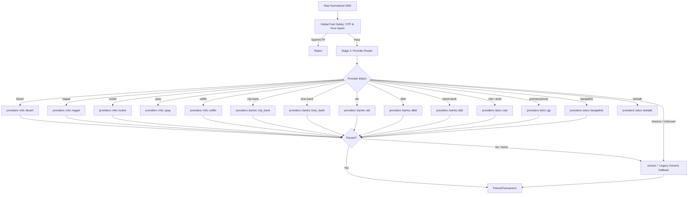

# Centwise Comprehensive Modular Parser Architecture & CSV Audit Plan

> **Document Type:** Complete Architectural Refactoring Specification & Verification Plan  
> **Target Module:** `core/centwise-parser` (Rust Core)  
> **Status:** Comprehensive & Approved for Execution  
> **Date:** October 2026  
> **Scope:** Full-Crate Modularization across Stage 1 (Classify), Stage 2 (Providers), and Stage 3 (Extract), verified by 16 CSV Audit Suites with Zero Regression.

## Execution Status

**Started:** 2026-10-21  
**Working rule:** behavior-preserving refactoring first; behavior changes require
new characterization tests and an explicit audit result. The existing working
tree is preserved and no PennyWise source, assets, or data are used.

### Baseline locked

- 16 audit CSV files are present under `fixtures/audits/`.
- The parser currently has 112 unit tests; the parser integration/audit tests
  also pass.
- `cargo test --workspace --locked` passes from `core/`.
- `cargo fmt --all --check` passes from `core/`.
- `cargo clippy --workspace --all-targets --locked -- -D warnings` passes from
  `core/`.
- The typed contract and dedicated-module dispatch tests pass; this confirms
  module routing, not completion of provider-specific extraction migration.
- Current provider detection is already called by `engine.rs`; the refactor
  must preserve that public behavior while adding provider-owned extraction.

### Plan corrections recorded before implementation

- The current repository has a `providers/` catalog/router and does not yet
  have `providers/mfs/`, `providers/banks/`, or `providers/telco/` modules.
  The implementation will introduce those modules without changing the public
  provider IDs.
- The catalog contains additional supported IDs (`upay`, `nexuspay`, several
  banks, and `airtel`) beyond the first module list. They remain on the generic
  fallback until their provider-specific behavior is characterized, or receive
  a dedicated module when the audit proves it is needed.
- Existing CSV audits are a mixture of exact assertions and diagnostic reports.
  Phase 6 will add a machine-checkable baseline comparison instead of treating
  printed metrics as proof of zero regression.

## Finalized Provider-Isolation Contract

This refactor is a behavior-preserving organization of the Rust engine. The
first pass must move existing rules without intentionally changing their
meaning. Any parsing improvement is a separate, explicitly tested change.

### Complete provider file inventory

Every canonical provider ID in `providers/catalog.rs` must have a dedicated
provider module. The generic provider is also explicit so its fallback role is
reviewable rather than hidden in a global extractor.

```text
providers/
├── generic.rs
├── mfs/
│   ├── bkash.rs
│   ├── nagad.rs
│   ├── rocket.rs
│   ├── upay.rs
│   ├── cellfin.rs
│   └── nexuspay.rs
├── banks/
│   ├── brac_bank.rs
│   ├── city_bank.rs
│   ├── dbbl.rs
│   ├── ebl.rs
│   ├── islami_bank.rs
│   ├── sonali_bank.rs
│   ├── pubali_bank.rs
│   ├── ucb.rs
│   ├── prime_bank.rs
│   ├── agrani_bank.rs
│   ├── mutual_trust_bank.rs
│   ├── standard_chartered.rs
│   ├── bank_asia.rs
│   ├── dhaka_bank.rs
│   ├── trust_bank.rs
│   ├── janata_bank.rs
│   └── rupali_bank.rs
└── telco/
    ├── robi.rs
    ├── grameenphone.rs
    ├── banglalink.rs
    ├── airtel.rs
    └── teletalk.rs
```

`banks-generic` is represented by `providers/generic.rs`; it is not allowed to
silently absorb a known provider's rules.

### Typed parser contract and dispatch order

Each provider module exposes the same typed entry point. It may return
`NotThisFormat` when the message is not that provider's recognized transaction
format; it must not return a partially invented transaction.

```rust
pub fn parse(sms: NormalizedSms<'_>) -> ProviderParse
```

`ProviderParse` contains optional provider-owned overrides for amount, fee,
balance, type, party, merchant, account, reference, date, and category. The
engine applies the following deterministic order:

1. Normalize text and run global OTP/spam/safety filters.
2. Detect the canonical provider ID.
3. Dispatch only to that provider module.
4. Use provider-owned values first; use shared primitives only for fields the
   provider did not override.
5. If the provider parser returns `None`, run the explicit generic fallback.
6. Reject messages with no valid amount or no transaction direction.

Provider modules must not call another provider module. Shared primitives must
not contain provider names, provider sender IDs, or provider-specific wording.

## PennyWise Reference Findings and Rust Adaptation

The in-repository PennyWise `parser-core` was reviewed as an architecture
reference only. Its useful design decisions are:

- one parser class/file per provider;
- a shared `BankParser` contract for common lifecycle behavior;
- optional regional/family base parsers for genuinely shared behavior;
- ordered factory dispatch, because sender IDs can overlap;
- parser-specific tests plus factory-routing tests;
- a registry that drives supported-provider documentation.

The Kotlin inheritance hierarchy must not be copied into Rust. Rust has no
class inheritance, and a large base implementation would recreate the same
global coupling this refactor is intended to remove. Centwise will use the
following Rust-native equivalent:

```text
NormalizedSms
    -> global safety gate
    -> candidate provider registry (ordered; may return multiple candidates)
    -> provider parser trait implementation
    -> shared primitives called by that provider
    -> explicit generic fallback
    -> ParsedTransaction / review rejection
```

### Rust parser contract

The implementation will introduce a small typed contract, conceptually:

```rust
pub trait ProviderParser {
    fn id(&self) -> ProviderId;
    fn can_handle(&self, sms: &NormalizedSms) -> bool;
    fn parse(&self, sms: &NormalizedSms) -> ProviderParse;
}

pub enum ProviderParse {
    Parsed(ProviderFields),
    NotThisFormat,
}
```

`ProviderFields` is typed and contains the provider-owned transaction fields;
it is not a JSON string. `NotThisFormat` means the registry may try another
candidate or the generic fallback. A parser never fabricates an amount,
direction, account, or reference.

### Composition instead of inheritance

Shared behavior is composed through small modules, not a large base parser:

- `common/amount.rs` — BDT minor-unit parsing;
- `common/account.rs` — generic card/account masking;
- `common/dates.rs` — date/time forms;
- `common/reference.rs` — transaction references;
- `common/phone.rs` — Bangladesh phone normalization;
- `common/text.rs` and shared safety helpers when required.

Family helpers may exist only when they have no provider names or provider
exceptions. A provider file may call shared helpers and then override the
fields that its SMS format defines differently. Provider-specific rules stay
inside that provider file.

### Registry and ambiguity handling

PennyWise's ordered factory behavior is important for Centwise too, but the
Rust registry must support more than one candidate. For example, sender `16216`
can identify Rocket or NexusPay depending on message content. The registry will
therefore:

1. return ordered candidates from sender/body evidence;
2. try the most specific provider parser first;
3. accept the first complete provider parse;
4. try the explicit generic fallback only after candidates decline;
5. preserve an unsupported/ambiguous message for review instead of inventing
   a provider result.

Registration order and overlap cases will have dedicated tests.

### Provider implementation standard

Every provider file must contain or directly own:

- canonical provider ID and sender/content matching;
- provider-specific safety/rejection rules;
- provider-specific amount, fee, balance, direction, party, account,
  reference, date, and category rules;
- anonymized positive, negative, invalid, and ambiguous examples;
- neighboring-provider non-regression coverage where sender IDs overlap.

The file may delegate genuinely generic field work to `common/`, but it may
not hide provider rules in `extract/` or a global catch-all module.

### Test and documentation workflow adapted from PennyWise

Centwise will use Rust equivalents of PennyWise's parser and factory tests:

- unit tests colocated with each provider module;
- fixture tests for the provider's anonymized SMS set;
- registry routing tests for sender IDs and body signatures;
- ambiguity/order tests for overlapping senders;
- row-level CSV audit tests with exact field comparisons;
- provider catalog/documentation consistency checks.

Adding a provider is complete only after its module, tests, fixtures, catalog
entry, and support documentation are updated together. PennyWise source code,
parser implementations, test data, and assets are not copied into Centwise.

## Revised Execution Plan Based on This Review

1. Freeze the current Centwise parser behavior and audit snapshot.
2. Introduce the typed Rust provider contract and ordered candidate registry;
   keep the current generic engine as the fallback during this step.
3. Convert one complete vertical slice first: bKash, including classifier,
   field extraction, parser module, routing tests, and CSV rows.
4. Convert the remaining MFS providers, then banks, then telcos one provider at
   a time. After each provider, remove only that provider's old global branches.
5. Keep family helpers small and generic; reject any helper that introduces
   provider-specific branching into `common/`.
6. Run the provider's unit/fixture/routing tests and the full CSV baseline after
   every provider migration.
7. Remove placeholder provider modules only after their real parser logic and
   tests are present; no placeholder file counts as completion.
8. Finish with full workspace tests, formatting, clippy, catalog consistency,
   and a documented list of any intentionally generic providers.

### Zero cross-impact and refactor safety rules

- A provider change may modify only its provider module, its provider fixtures,
  and its provider tests unless a shared contract genuinely changes.
- Every provider gets positive, negative, invalid, and unsupported-format tests.
- A provider test must include at least one regression case proving that a
  neighboring provider's message remains unchanged.
- The baseline audit runs before and after every provider family.
- Existing expected outputs are immutable during move-only phases.
- No source line is removed merely because it is difficult to classify; it is
  first moved, wrapped, or covered by a characterization test.

### Row-by-row CSV audit contract

Every row in all 16 CSV files must be processed individually. The audit output
must include source file, row number, sender, provider, outcome, and field-level
differences for:

- amount and fee;
- balance after;
- transaction type and category;
- party and merchant;
- account hint/last four;
- reference and date;
- rejection reason when no transaction is expected.

Aggregate parsed/rejected totals are necessary but not sufficient. A CSV audit
passes only when the locked baseline totals and the expected field-level result
for every characterized row remain unchanged. Uncharacterized rows remain
visible in the audit report and must never be silently discarded.

The consolidated direct-text input is
`fixtures/audits/all-sms-test-input.csv`. It has one SMS per row in the
`message_text` column; source kind, source file, source row, and sender remain
separate metadata columns. The row-level test also checks that direct text
preserves amount, balance, fee, account, party/merchant, provider, reference,
and safe rejection behavior. The fixture is sanitized and line-normalized; it
is not a source of verbatim personal SMS data.

### Verification commands

Run from `core/` after each family and at final sign-off:

```text
cargo test -p centwise-parser --locked
cargo test --workspace --locked
cargo fmt --all --check
cargo clippy --workspace --all-targets --locked -- -D warnings
```

Provider-specific tests are selected through Rust module/test filters, for
example `cargo test -p centwise-parser providers::mfs::bkash`, because all
providers are modules in one parser crate rather than separate crates.

### Completed work log

| Date | Work | Verification |
|---|---|---|
| 2026-10-21 | Repository audit and baseline lock | Workspace tests, parser tests, fmt check, and clippy all passed |
| 2026-10-21 | Added `common/amount.rs` and `common/phone.rs`; moved CellFin `FROM:` account extraction into `providers/mfs/cellfin.rs` | Parser suite: 108 passed; all parser CSV integration tests passed; fmt check passed |
| 2026-10-21 | Moved date/reference primitives behind `common/` compatibility facades; moved bKash intermediary-recharge filtering into `providers/mfs/bkash.rs` | Parser unit suite: 110 passed; fmt passed |
| 2026-10-21 | Moved generic account/card extraction into `common/account.rs`; retained `extract/account.rs` as a compatibility facade | Parser unit suite: 110 passed; the previous account characterization tests remain green |
| 2026-10-21 | Added a locked all-16 CSV audit baseline covering parsed/rejected totals per report | All 16 reports loaded; baseline assertions passed |
| 2026-10-21 | Added the complete provider inventory, typed parser contract, dispatch precedence, isolation rules, row-level audit requirements, and exact verification commands | Parser tests, workspace tests, fmt check, and clippy all passed |
| 2026-10-21 | Created the complete provider module tree: 17 bank files, 6 MFS files, 5 telco files, and explicit generic fallback | `cargo test -p centwise-parser --locked`: 110 passed; all CSV integration tests passed; formatting passed |
| 2026-10-21 | Added typed contract dispatch tests proving every catalog provider reaches its dedicated parser module | `cargo test -p centwise-parser --locked`: 112 unit tests plus all parser CSV integration tests passed |
| 2026-10-21 | Ran final verification for the current refactor checkpoint | `cargo test --workspace --locked`, `cargo fmt --all --check`, and `cargo clippy --workspace --all-targets --locked -- -D warnings` passed |
| 2026-10-21 | Moved bKash iBanking-deposit counterparty extraction out of the global party extractor into `providers/mfs/bkash.rs`; retained characterization coverage | `cargo test -p centwise-parser --locked`: 113 unit tests plus all parser CSV integration tests passed |
| 2026-10-21 | Audited all 4,714 CSV SMS rows and fixed posted investment disbursement classification; the SJIBL queue row now parses as income and no review item remains unexpectedly queued | All 16-report baseline updated for queue 05 to 323 parsed / 32 rejected; row-level audit reports 0 queue-05 discrepancies and 0 unexpected queued rows |
| 2026-10-21 | Fixed utility prepaid-recharge amount precedence so the posted `Tk 1000` is selected before a nested rebate value such as `4.74` | Added amount characterization coverage; the full audit still reports 4,540 parsed rows, with no new rejection or queue regression |
| 2026-10-22 | Moved bank body-signature detection out of the global router into all 17 dedicated bank modules; added EBL-owned Skybanking MFS-transfer rule and tests | `cargo test -p centwise-parser --locked providers::banks::ebl`: 2 provider tests passed; full parser suite remained green |
| 2026-10-22 | Added provider-owned BRAC FD-renewal rejection and City Bank CityTouch ATM recognition/category rules with characterization tests | `cargo test -p centwise-parser --locked providers::banks`: 6 bank tests passed; full audit counts unchanged |
| 2026-10-22 | Added provider-owned event-family rules and tests for all 17 banks; added one anonymized official-service-family fixture per bank, completed the provider catalog, and recorded official public-source limitations | Parser: 135 unit tests plus all integration/audit tests passed; workspace tests, fmt check, and clippy passed |
| 2026-10-22 | Consolidated every SMS row from all 16 CSV reports into one sanitized, one-line-per-message `message_text` input; added direct-text field coverage and fixed BRAC `A/C#`/hyphen account formats plus Nagad sender fields without punctuation | Consolidated audit: 4,532 parsed, 182 safely rejected, 0 unsafe review rows; direct field coverage: balance 3,878/3,878, fee 1,283/1,283, account 1,382/1,382, party/merchant 803/803; targeted test passed |

### Implementation progress

- [x] Baseline locked and plan inconsistencies documented.
- [x] Shared amount and recharge-phone primitives introduced without changing
  parser results.
- [x] CellFin-specific account extraction isolated behind the MFS provider
  boundary.
- [x] Date and reference extraction isolated as provider-independent common
  primitives.
- [x] Generic account/card extraction isolated as a common primitive.
- [ ] Remaining MFS and telco provider rules isolated; all 17 bank provider rules are now module-owned.
- [x] Machine-checkable all-16-report parsed/rejected baseline comparison added.
- [x] Complete provider inventory and provider-isolation contract documented.
- [x] Dedicated source files exist for every catalog provider ID.
- [ ] Existing provider-specific extraction/classification logic moved into all
  dedicated files (bank event-family rules are complete; MFS/telco cleanup
  remains).
- [x] Row-level audit output requirements documented; field-level expected
  snapshots remain to be implemented.

---

## 1. Complete Codebase Audit: The 3 Layers of Entanglement

A complete inspection of every source file in `core/centwise-parser/src/` reveals that provider-specific logic is scattered across **all three stages** of the engine, not just `amount` and `party`:

```text
core/centwise-parser/src/
├── classify/
│   ├── mod.rs (22.4 KB, 550 lines)   <-- Entangled with bKash notices, bank cheques, FD rollovers
│   ├── telco.rs (16.6 KB, 395 lines) <-- Entangled with GP/Robi/BL specific USSD and bundles
│   └── otp.rs (7.7 KB, 203 lines)   <-- Clean generic OTP filter
├── providers/
│   ├── catalog.rs (3.8 KB, 76 lines) <-- 22+ canonical provider IDs and sender mappings
│   └── mod.rs (8.0 KB, 234 lines)   <-- Provider detector (currently discarded in Stage 3!)
├── extract/
│   ├── amount.rs (19.0 KB, 477 lines)<-- Entangled with bank/MFS specific balance & fee patterns
│   ├── party.rs (18.5 KB, 484 lines) <-- Entangled with MFS counterparty & bank POS merchant parsing
│   ├── tx_type.rs (11.4 KB, 291 lines)<-- Entangled with MFS transfer vs Bank clearing (RTGS/NPSB)
│   ├── account.rs (5.7 KB, 157 lines)<-- Hardcoded Cellfin 'FROM:' logic & bank card patterns
│   ├── reference.rs (3.3 KB, 110 lines)<-- Generic TrxID / STAN / RRN / NPSB ref extractor
│   ├── date.rs (3.0 KB, 91 lines)   <-- Generic DMY / ISO / Named month extractor
│   └── mod.rs (3.1 KB, 100 lines)   <-- Categorization & Telco recharge prefix resolver
└── engine.rs (15.3 KB, 347 lines)   <-- Monolithic coordinator
```

---

## 2. File-by-File Breakdown of Hidden Couplings

### Layer 1: Classification & Filtering (`classify/`)
1. **`classify/mod.rs` (22.4 KB):**
   - **bKash hardcoding:** `lower.contains("your bkash mobile recharge request")` (line 52) to discard intermediate requests without TrxIDs.
   - **Bank administrative hardcoding:** Rejection of cheque book requests, debit card renewals, and loan outstanding certificates.
   - **Fixed Deposit & Insurance:** Rollover notices and policy renewal filters.
2. **`classify/telco.rs` (16.6 KB):**
   - Banglalink `Ghechang Recharge`, `MyBL`, Robi `MyRobi`, GP `MyGP`, USSD dial menus (`*121*`, `*123*`, `*212*`).

### Layer 2: Field Extraction (`extract/`)
1. **`extract/amount.rs` (19.0 KB):**
   - Mixed extraction of `amount`, `fee`, and `balance_after`.
   - City Bank postfix withdrawal patterns, Robi emergency loan repayments, bKash fee patterns all compete in the same global functions.
2. **`extract/party.rs` (18.5 KB):**
   - MFS counterparty resolution (`Send Money to 017...`, `Cash In from 018...`) mixed with Bank POS/Merchant signatures (`at SHWAPNO`, `via Citytouch`) and Telco recharge targets.
3. **`extract/tx_type.rs` (11.4 KB):**
   - Directionality rules: `Send Money` (Expense for MFS vs Transfer for Bank), `BEFTN/RTGS/NPSB` credit vs debit.
4. **`extract/account.rs` (5.7 KB):**
   - Line 56 explicitly hardcodes: `if text.to_lowercase().contains("cellfin")` to parse `FROM: <account_digits>`.
5. **`extract/mod.rs` (3.1 KB):**
   - Hardcodes mobile operator prefix routing (`017/013` -> GP, `018` -> Robi, etc.) for recharge categorization.

---

## 3. The Target Clean Architecture

Instead of having bank exceptions scattered across 6 different files, **each provider owns its complete lifecycle** (safety check, directionality, amount/balance/party/account extraction), while reusing clean shared primitives.



---

## 4. Reusable Common Primitives (`common/`)

Shared domain rules that are identical across all banks will live in `common/`:

| Module | Responsibility |
|---|---|
| `common/amount.rs` | Integer minor units parsing (`Tk 125.50` -> `12550`), comma handling, BDT normalization |
| `common/dates.rs` | DMY (`22/08/2026`), ISO (`2026-08-22`), Named month (`29-APR-26 12:47 AM`) |
| `common/account.rs` | Generic Card masking (`Card *1234`), Generic A/C masking (`A/C XXXX1234`) |
| `common/reference.rs` | Authoritative TrxID, STAN, RRN, Ref No, NPSB/BEFTN Ref |
| `common/phone.rs` | Bangladeshi mobile number normalization (013-019), telco prefix identification |

---

## 5. Comprehensive Provider Modules

Each provider file will encapsulate its specific rules:

### 5.1 MFS Modules (`providers/mfs/`)
- **`bkash.rs`:**
  - Rejection: Intermediary recharge request notices (`your bkash mobile recharge request`).
  - Fields: `Fee Tk X`, `Balance Tk Y`, `TrxID XYZ`, `to <party>`, `from <party>`.
  - Types: Send Money (Expense/Transfer), Cash In (Income), Payment (Expense), Cash Out (Expense).
- **`nagad.rs`:**
  - Fields: `TxnID:`, `Sender:`, `Recipient:`, `Amount: Tk`, `Fee: Tk`, `Balance: Tk`.
- **`rocket.rs` & `nexuspay.rs`:**
  - Rocket un-prefixed balance, 16216 sender differentiation, NexusPay EFT/Card alerts.
- **`cellfin.rs`:**
  - Specific `FROM: <account_digits>` parsing, i-banking deposit party matching.

### 5.2 Commercial Banks (`providers/banks/`)
- **`city_bank.rs`:**
  - Citytouch, Amex card alerts, POS terminal debit, SMS alert fee debit.
- **`brac_bank.rs`:**
  - Astallion alerts, account debit/credit, card ending format.
- **`ebl.rs`:**
  - EBL Skybanking, Connect debit/credit, POS and ATM withdrawal formats.
- **`dbbl.rs`:**
  - Core banking vs Rocket split, ATM fast cash.
- **`ibbl.rs`:**
  - Mudaraba account alerts, i-Banking, profit credit.

### 5.3 Telecom Operators (`providers/telco/`)
- **`gp.rs`, `robi.rs`, `banglalink.rs`, `teletalk.rs`:**
  - Specific USSD menu rejections (`*121*`, `*123*`, `*212*`).
  - Data packs (`1.5GB at Tk 43`), Voice packs (`50 Mins at Tk 34`), VAS auto-deductions (`Welcome Tune`), Emergency Balance loan credits & repayments.

---

## 6. The 16 CSV Audit Datasets Inventory

All 16 CSV files located in `fixtures/audits/` will be systematically validated:

### 6.1 Review Queue Reports (Edge Cases & Rejections)
1. `review-queue-report-01.csv` (79.4 KB) - Unparsed candidate SMS & false negatives
2. `review-queue-report-02.csv` (3.3 KB) - Complex multi-number SMS
3. `review-queue-report-03.csv` (98.5 KB) - Long bank notifications & statements
4. `review-queue-report-04.csv` (2.3 KB) - Difficult telco messages
5. `review-qeue-report-05.csv` (81.6 KB) - Recent user submission review reports

### 6.2 Transaction Reports (Positive Flow Verification)
1. `transaction-report-01.csv` (146.9 KB) - High-volume general transactions
2. `transaction-report-02.csv` (144.0 KB) - bKash & Nagad payments and cashouts
3. `transaction-report-03.csv` (126.6 KB) - Card debits, POS, and online shopping
4. `transaction-report-04.csv` (26.6 KB) - Mobile recharges across GP, BL, Robi
5. `transaction-report-05.csv` (25.6 KB) - City Bank & Eastern Bank transactions
6. `transaction-report-06.csv` (29.8 KB) - BRAC Bank & DBBL card transactions
7. `transaction-report-07.csv` (29.0 KB) - Mixed MFS deposits & P2P transfers
8. `transaction-report-08.csv` (33.9 KB) - VAS subscriptions & pack deductions
9. `transaction-report-09.csv` (45.4 KB) - Salary credits, BEFTN, NPSB inflows
10. `transaction-report-10.csv` (31.9 KB) - Bank annual fees, SMS charges, ATM cash
11. `transaction-report-011.csv` (130.1 KB) - Recent high-density production transactions

---

## 7. Step-by-Step Implementation Roadmap

```text
[Phase 1: Baseline Lock]
  ├── Verify all 106 existing unit tests pass
  └── Record baseline parse/reject metrics across all 16 CSVs

[Phase 2: Common Primitives Extraction (`common/`)]
  ├── Extract common amount/minor unit conversion to `common/amount.rs`
  ├── Extract common date/time regexes to `common/dates.rs`
  ├── Extract common account/card helpers to `common/account.rs`
  └── Ensure `extract/` uses `common/` without changing test behavior

[Phase 3: MFS Modularization (`providers/mfs/`)]
  ├── Create `providers/mfs/bkash.rs` (move bKash notices, party, fee, amount rules)
  ├── Create `providers/mfs/nagad.rs`
  ├── Create `providers/mfs/rocket.rs`
  ├── Create `providers/mfs/cellfin.rs` (move Cellfin `FROM:` logic from `account.rs`)
  └── Run MFS CSV tests (reports 01, 02, 07) -> Assert 0 regressions

[Phase 4: Bank Modularization (`providers/banks/`)]
  ├── Create `providers/banks/city_bank.rs` (move City Bank amount/fee patterns)
  ├── Create `providers/banks/brac_bank.rs`
  ├── Create `providers/banks/ebl.rs`
  ├── Create `providers/banks/dbbl.rs`
  ├── Create `providers/banks/ibbl.rs`
  └── Run Bank CSV tests (reports 03, 05, 06, 09, 10) -> Assert 0 regressions

[Phase 5: Telco Modularization (`providers/telco/`)]
  ├── Move GP, Robi, BL, Teletalk pack/recharge/VAS logic to `providers/telco/`
  ├── Clean up `classify/telco.rs` to keep only generic dial menus
  └── Run Telco CSV tests (reports 04, 08) -> Assert 0 regressions

[Phase 6: Full CSV Audit Sweep & Precision Fixes]
  ├── Run automated audit across all 16 CSVs
  ├── Identify any remaining false negatives in review queues 01-05
  └── Fix edge cases within isolated provider files without global side-effects

[Phase 7: Verification & Final Sign-Off]
  ├── `cargo test --workspace --locked` (106+ tests)
  ├── `cargo clippy --workspace --all-targets --locked -- -D warnings`
  └── `cargo fmt --all --check`
```

---

## 8. Definition of Done

- [ ] Every bank and MFS provider has its own dedicated source file.
- [ ] No hardcoded provider checks remain inside `account.rs`, `tx_type.rs`, or `classify/mod.rs`.
- [ ] Generic fallback in `extract/` is preserved as Tier-2 safety net.
- [ ] All 106 existing unit tests pass identically.
- [ ] All 16 CSV audit reports are evaluated with zero cross-provider regressions.
- [ ] Code formatting and clippy lints pass with zero warnings.

---

## 9. Implementation and Public-Source Audit Log (2026-10-22)

The bank boundary is now implemented for all 17 bank providers currently in
the Rust router. Each bank module owns at least one event-family predicate and
its parse/rejection behavior; the shared parser is used only for common field
extraction. Provider-specific coverage includes ATM/cash withdrawal, POS/card
spend, fee/charge, loan auto-debit, transfer, and clearing-cheque-return
families where the provider's public service documentation supports them.

Added:

- `fixtures/sms/banks-official-service-families.json` with one anonymized
  fixture per bank provider and a fixture integration test.
- Provider catalog entries/status for all 17 bank modules.
- Provider-owned tests for every bank module, including the previously empty
  bank boundaries.
- A public-source limitation note in the fixture: official bank pages confirm
  alert/event families, but do not publish stable raw SMS templates. Therefore
  fixture bodies are synthetic and anonymized format-family tests, not copied
  verbatim messages.

Official source references used for the service-family audit:

- Sonali Bank [SMS Banking](https://www.sonalibank.com.bd/sms-services.php)
- Pubali Bank [SMS Alert Service](https://www.pubalibangla.com/SMSAlertService)
- Janata Bank [Citizens Charter](https://www.janabank.com/images/policies/citizens-charter.pdf)
- Rupali Bank [Debit Card and Transaction Alert](https://www.rupalibank.com.bd/rupali_debit_card.php)
- Agrani Bank [ICT Security Policy, SMS Banking section](https://www.agranibank.org/assets/others/manuals/Information_Communication_Technology_Security_Policy_of_Agrani_Bank_Limited-20211.pdf)
- Islami Bank [SMS Service](https://www.islamibankbd.com/digital-banking/sms-service)
- UCB [SMS Banking](https://www.ucb.com.bd/banking/sms-banking)

This source audit does not claim that a synthetic body is the exact production
template emitted by a bank. Exact-template support requires additional safe,
anonymized SMS samples from each bank/customer device and must be added as a
separate fixture review without introducing personal data.
